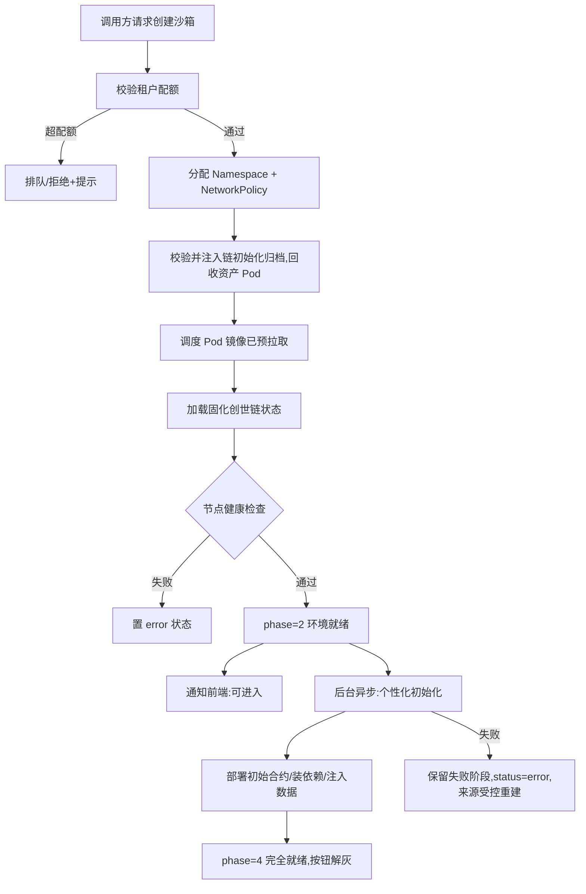
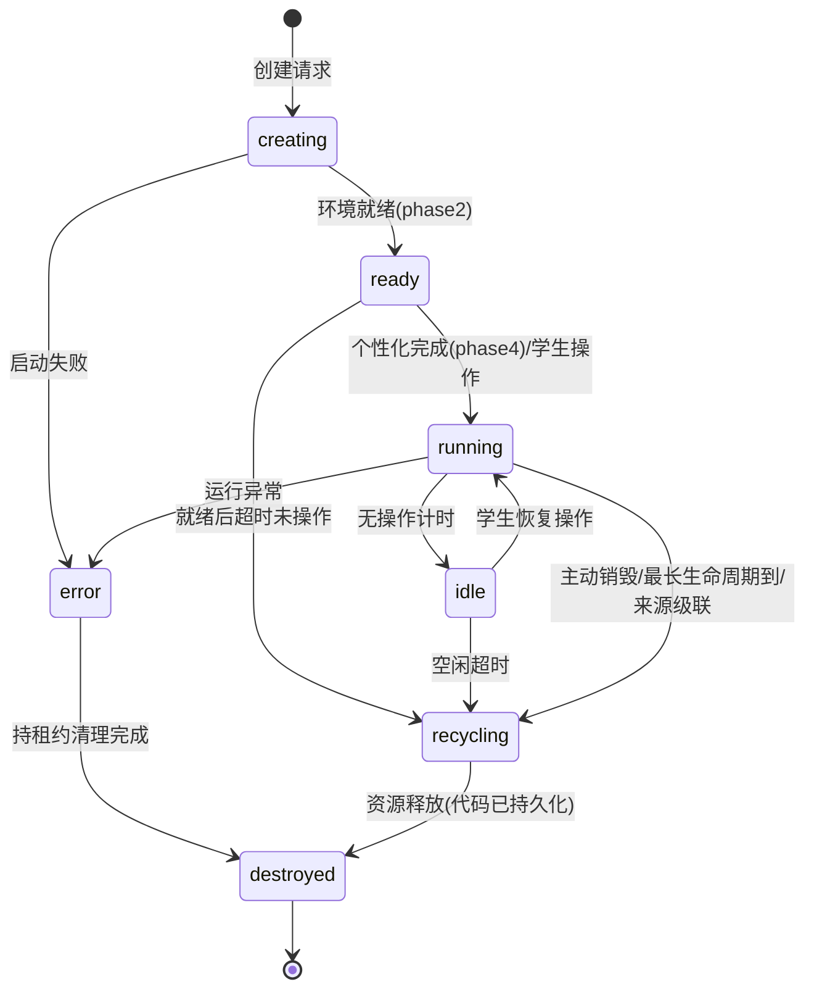
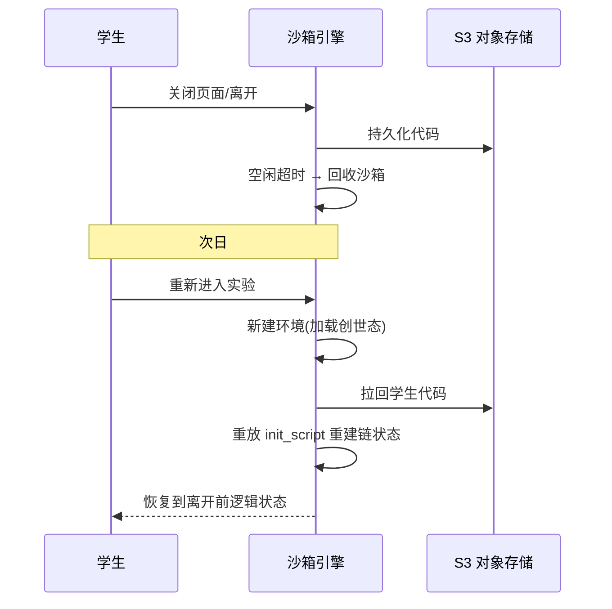
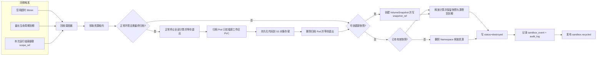
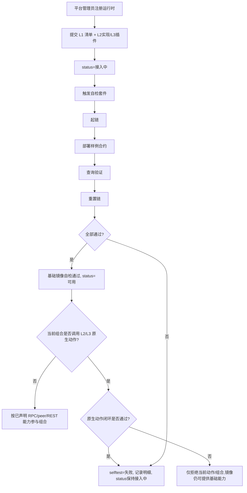
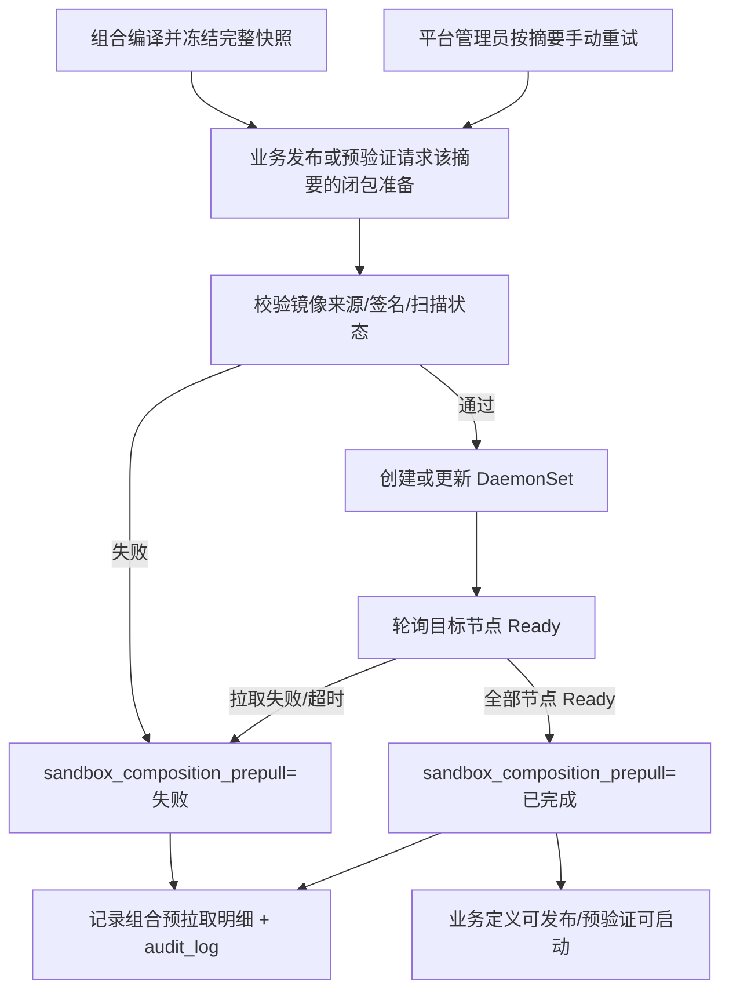
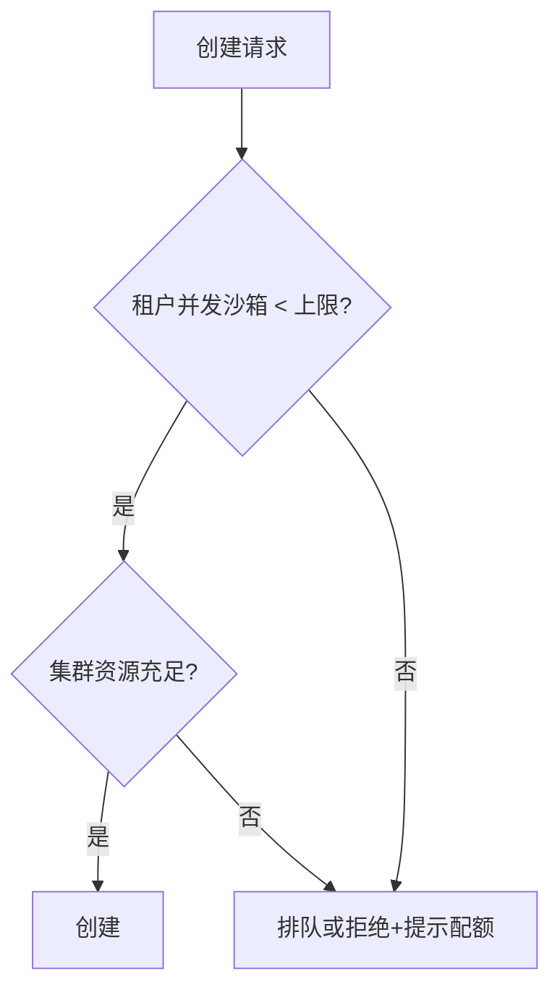

# M2 沙箱引擎 — 业务流程与状态机

> 用 Mermaid 描述沙箱启动、生命周期、回收、适配器接入流程。
> 最后更新:2026-11-21

---

## 1. 分阶段启动流程

阶段一(A→G,目标 ≤5s)完成即让学生进入;阶段二(I→K)后台补齐。需要个性化初始化的沙箱必须在 `phase=3` 完成前保持工作面不可操作,只有 `phase=4` 才能进入完整工作台;没有个性化初始化的沙箱在 `phase=2` 可进入。
初始化期间先校验完整资源计划,再启动运行时及冻结连接图中 `required_at_start` 的全部传递前置组件,其余工具等工作区代码和脚本处理完成后再启动。所有声明的 Service 在消费者启动前建立;每阶段只等待本阶段实际创建的 Pod,不能等待被延后的组件,也不能跳过其预检。前置组件从已校验摘要的冻结连接图推导,不按目录分类或数组顺序猜测。
有初始化任务时,基础环境准备完成直接发布 `phase=3`,不暴露短暂可执行的 `phase=2`;生命周期仍经 `ready` 进入 `running`,阶段与生命周期共同决定操作权限。文件、终端、链操作、判题等待及提交门禁只接受 `phase=2/4` 且 `status=ready/running/idle`,不以阶段数值大小判断就绪。暂停、回收中、已销毁、失败和初始化中均不可操作。
异步启动推进与通用状态流转须在同一事务内先取得沙箱权威行锁,再校验当前状态、更新并记录事件；该锁与文件保存/归档及回收更新共用同一沙箱行。回收先提交时,迟到启动停止推进且不写事件；启动先取得锁时,回收等待该短事务完成后接管,不能用锁前旧状态覆盖回收中或已销毁终态。
首次启动、暂停恢复和快照恢复共用一个启动流程。暂停或快照恢复先用数据库条件更新切换到 `creating`；启动执行者原子领取资源租约，跨副本只允许一个执行者操作同一沙箱。启动、回收和过期快照清理复用 `resource_lease_token/resource_lease_until`，租约有效时其他执行者不操作资源，不跨 Kubernetes 操作持有数据库事务。启动状态写回必须匹配租约令牌，失去执行权的旧任务不能推进状态或报告失败。暂停恢复保留已完成初始化的阶段，不重放首次初始化材料或脚本；同步恢复调用须复核当前环境可执行，再进入 `running`，不能把未取得执行权当作恢复成功。

启动失败只在仍持有租约且处于启动阶段时写入失败与技术事件、释放租约，再由既有回收任务清理；不在迟到任务的失败分支直接删除资源。进程中断后租约到期，未进入初始化的 `creating` 可重新领取；已进入初始化或已留下未完成资源操作的记录标记失败，不能重放未确认完成的脚本。资源租约未释放时不开学生执行入口；自动空闲转换只接受 `phase=2/4` 且无活动租约的记录。

保留环境恢复与新建共用租户容量规则。恢复事务先锁租户配额，再锁沙箱并读取当前计数，最后条件切换到 `creating`；暂停环境已在计数内，已销毁快照恢复增加一个占用。并发数或 CPU/内存总容量不足、权威状态变化、配额读取失败时，不改变生命周期或启动资源。

失败、初始化未完成或快照保留已过期的环境不新建快照。仍有效的既有快照及源卷保留到期，其他资源直接清理，避免损坏的组合或已删除计算资源再次阻塞回收。暂停也使用相同资源租约，保留已完成初始化的阶段。
首次启动、暂停恢复和快照恢复均须在开放 `phase=2/4` 前,由非学生目标执行 `workspace_ops.clean_workspace` 清除根平台脚本副本;清理失败不得开放文件、终端或工具。创建依赖校验与恢复入口须先校验私有脚本目标和命令,缺少声明的历史组合明确不可启动,保留业务记录/代码/快照供正常新发布流程使用,不以学生入口回退执行。
工具准备独立于沙箱阶段推进,网页工具和受控命令工具还必须以 `tool_access[].status=ready` 为操作前置。工具仍在启动时,工作台继续重读同一沙箱详情并展示准备状态,不提前换取浏览器票据、创建 iframe 或执行命令;失败时明确提示并允许重新读取权威状态。实验与竞赛复用同一工作台规则,不以沙箱已就绪替代工具已就绪。
工具集合与入口只从冻结组合推导，不写第二套挂载或健康状态，也不启动后台探测写回任务。每次读取及执行检查当前 Pod 与端点；等待、缺失或端点未收敛显示准备中，Pod 已失败、镜像拉取失败、容器崩溃、已退出或当前 Pod 创建后超过既有启动/探针预算显示失败；资源恢复后重读即可重新开放。查询失败汇总工具标识与完整错误链，明确返回读取错误，不沿用旧结果。
资源编排以 `CreateSandboxResources` 的幂等创建和规格核对为唯一启动路径，首次创建、暂停恢复及快照恢复共用该入口。恢复先核对所有不在已提交快照中的保留卷；缺失或正在删除时立即失败，不创建空卷。其余缺卷仅从已提交的对应快照恢复，现有 PVC 只核对归属与规格，不改创建来源。首次分配仍允许空卷，链重置沿显式清空账本流程执行。创建 Namespace 和该沙箱专属 RBAC 后再读取资源，不在首次创建前做 Pod 就绪探测，也不以探测异常作为替代创建的 fallback。阶段一及阶段二任一步失败统一保留失败阶段、进入 `error`，记录错误事件并发布带 `tenant_id`、`sandbox_id`、`source_ref`、`scope_ref` 和 `trace_id` 的 `sandbox.failed`，供来源模块对账及受控回收。终态写入与事件使用独立有界上下文，不被原执行超时取消。恢复失败释放计算资源并保留 PVC 与快照；失败不开放工作面，也不自动重放未证明幂等的初始化脚本；由原来源的重建入口保存已持久化代码与进度、回收旧计算资源，再创建新环境。

后台回收周期扫描超过启动预算的启动记录：`creating` 从冻结组合重新调度幂等资源创建；`phase=3` 且生命周期为 `ready/running` 的中断初始化转为失败，交由既有回收与来源重建流程处理，不自动重放脚本。扫描结果写回前在行锁内复核阶段、生命周期和更新时间，不能覆盖扫描后完成或更新的环境。详情读取不承担启动副作用。快照恢复只重建计算资源，不重放首次初始化资产与脚本。恢复扫描复用已有轮询、批量和启动超时配置，不增加第二套任务配置。失败状态及技术事件提交成功后才发布通知；事务提交失败不能对外宣称状态已改变。单轮扫描汇总全部失败，保留各条错误链。

---

## 2. 沙箱状态机

正常环境以 `recycling` 表示待回收；失败环境保留 `failed`，避免重试丢失失败事实后重新归档损坏环境或创建快照。两者共用同一回收流程：执行者原子领取资源租约，执行期间续租，决策以领取后返回的权威记录为准。步骤失败时仅当前持有者可释放租约、记录错误事件，保持当前状态供重试；进程中断后租约到期即可重新领取。完成时持租约者在同一事务中写入 `destroyed`、回收事件和 outbox，并清除租约。

`recycle_saved` 只记录本次回收的最终归档是否已完成，与旧归档引用不同。首次进入回收时清零；回收中的归档与该标记在同一事务提交，重试只有看到此标记才跳过归档，不能用非空 `code_hash` 推断最终代码已保存。恢复保留资源时重置该标记。暂停完成前先停止续租，再持有效租约原子释放执行权并写入 `paused`；停止续租自身的取消不作为续租失败。

文件写入和归档在取得权威行锁后再次检查当前状态和执行权。普通保存及防抖保存只接受可执行且没有资源租约的环境；暂停与回收保存必须匹配当前未过期资源租约。快照引用提交也必须匹配租约，旧执行者不能覆盖新快照。

资源租约只阻止新操作，不能结束已有终端、IDE 或后台进程。暂停及正常回收领取租约后，先正常删除全部计算 Pod 并等待退出，再用冻结工作区镜像创建仅挂载原 `workspace` PVC 的归档 Pod；不重启链节点、初始化容器或工具。归档目标按租约生成独立名称，不复用学生终端目标；无学生入口、业务端口、链卷或私有资产，只执行平台归档命令。保存完成后删除并等待归档 Pod 退出，再采集快照及清理运行配置。失败保留原 PVC 与租约重试规则，不能用强制删除冒充进程已停。归档恢复缺失 PVC 时直接失败，不新建空卷替代未保存内容。

暂停失败或执行中断不能等同于运行环境内容损坏。当前暂停执行者失败后，将环境与错误事件原子登记为 `recycling` 并释放自己的租约，由既有回收路径重试最终归档和清理；后台对过期暂停租约执行同一处理，并在锁内复核租约尚未续期。登记失败保留租约供到期重试，不能放开无计算资源的环境，也不能转为跳过归档的 `failed`。

创建、暂停、恢复及回收完成的审计复用当前数据库事务，与状态和技术事件一起提交。审计失败回滚本次状态写入；不在已提交创建记录后再直接删除 Kubernetes 资源或补写销毁状态。

过期快照清理复用同一租约字段，但只认领 `destroyed` 且快照已过期的沙箱。删除 Namespace 前先原子认领并在清理期间续租；恢复入口必须在数据库条件更新中确认快照仍未过期且没有活动清理租约。删除成功后，持租约者清空快照引用和过期时间并释放租约；失败时只释放自己的租约并记录错误事件。这样恢复与清理由数据库状态和租约串行化，不依赖扫描结果的时效。

- **ready 态超时回收**(B6 修复):就绪后长时间未操作(如 10min)直接回收,防止就绪沙箱僵尸占用。
- **回收事件通知来源**(A4 修复):沙箱成功进入 `destroyed` 后,通过 outbox 发布 `sandbox.recycled` 事件(携带稳定 `source_ref` 和本次 `scope_ref`),来源方(experiment/contest)订阅后同步更新自身实例状态,避免上游仍持 `sandbox_ref` 而沙箱已销毁的悬挂。上游恢复(resume)前应探活,已销毁则按原组合快照 digest 触发重建(代码已持久化 + 重放部署脚本)。用事件而非反向接口调用,避免 sandbox 反向依赖业务层(见工程目录设计 §3.1.1)。

- 正常环境进入 `recycling` 后先完成最终代码归档，再删除资源；失败或从未开放工作区的环境不重新归档。
- `keep_alive=true` 的沙箱:`idle` 不触发空闲回收,但仍受 `keep_alive_until`、`expire_at`、租户并发与资源配额约束。
- 来源模块核对回收终态只读取持久化生命周期和冻结组合身份，不受当前目录自检状态影响。冻结组合须重新计算摘要并与组合声明及沙箱记录同时相等；读到终态不能绕过新建、恢复、学生交互或归档重建的当前准入校验。

---

## 3. 断点续做(默认重建)

---

## 4. 回收流程(三重保证)

回收失败处理:
- 计算 Pod 已终止时，只通过归档 Pod 挂载原工作区保存，不重启运行时、工具或初始化容器；原 PVC 缺失或归档失败时保留资源并重试，不新建空卷替代未保存内容。
- 任一步骤失败:保留尚未释放的资源,当前租约持有者记录错误事件并释放租约;正常环境保持 `recycling`，失败环境保持 `failed`，等待调度器重新领取。
- 快照成功:由于 CSI `VolumeSnapshot` 是 namespaced 资源,不得立即删除所在 Namespace;必须删除计算工作负载并等待 Pod 全部退出后再清理服务和安全配置，保留 PVC/VolumeSnapshot/Namespace 至 `snapshot_expire_at`,由过期清理任务删除。
- 快照失败:补偿删除本次新建的快照，保留已有快照及源 PVC；补偿使用独立有界上下文并保留失败错误链。保留 Namespace,按回收失败规则释放租约并等待重试,不得删除快照源资源或写 `destroyed`。
- K8s 删除失败:保留当前回收状态，释放租约后由调度器重试，不得写 `destroyed`。

快照过期清理与恢复使用同一数据库租约互斥。清理任务必须原子认领过期快照并在删除 Namespace 期间续租;恢复必须用条件更新检查数据库中的过期时间和活动租约。清理失败保留快照引用并释放租约以供重试;清理成功后清空快照引用,避免已删除资源仍被显示为可恢复。

每次快照组由当前资源租约派生唯一名称，恢复卷的数据源取自已提交的 `snapshot_ref`，不再仅按沙箱 ID 推导固定名称。新组全部 Ready 且引用已提交后，释放计算时按沙箱所有权标签清理旧组；失败只删除本次新建的组，旧组保留。这样连续暂停或回收会采集当前卷状态，不会将旧快照重新标记为最新。

---

## 5. 运行时接入即测流程

基础镜像自检通过的运行时即可对组合调用方提供 manifest 声明的 RPC、peer、REST 等基础能力;L1 只在组合实际调用未声明的原生动作时拒绝该动作,不能把整个镜像标成接入中或从目录隐藏。原生动作闭环单独记录为动作能力状态,不改变基础镜像准入状态。每次自检启动时必须在事务内锁定待测运行时镜像和当前能力证明,生成唯一 `attempt_id`,并把本批次自检标记为进行中;完成时仅允许批次一致的结果写回。并发修改执行契约、停用运行时或后发自检会使旧批次自然失效,旧结果不得恢复过期配置的能力状态。自检启动后即使发起端断开,服务端也必须在有界上下文内完成资源清理和条件状态回写。

运行时接入自检与判题器平台组合自检都以执行完成且临时资源回收完成作为成功条件。执行预算结束不得写成通过;回收使用脱离发起请求的独立配置预算,回收失败必须合并到本次结果。运行时仅回收失败时明细复用 `stage=recycle` 的“回收环境”语义,执行和回收同时失败时保留两条内部错误链,界面只返回失败状态、阶段和报障编号。沿用原尝试标识条件写回,不以清理异常重新发起自检或恢复已失效的结果。

### 5.1 多镜像交互验证

组合内镜像默认相互隔离,不会因为同属一个实验或竞赛环境而自动共享状态。只有冻结快照中的 `links`、编译生成的 Service/DNS 与环境绑定、显式 NetworkPolicy,或经校验的共享卷安全域,才构成可执行的交互路径。测试必须覆盖“源组件执行动作 -> 目标组件通过自身协议观察到状态变化 -> 断开未声明连接仍被拒绝”三步;只验证两个 Pod 都为 Ready 不算交互通过。

网络交互使用目标组件真实端点和协议,例如 Blockscout 必须经组合绑定的 EVM RPC 查询运行时,Fabric Explorer 必须经 peer/orderer 端点和只读 `runtime-state` 读取身份。工作区文件共享与链运行态共享是两个不同安全域;写入 `workspace` 不会自动改变 `runtime-state`,写入链状态也不会自动出现在学生文件接口。首次创建和快照恢复都必须先建立 Service,再按 `required_at_start` 拓扑创建并等待 Pod,避免消费者先于目标服务获得可解析地址。

## 6. 镜像预拉取流程

目录只返回已审核的运行时、镜像和组件能力,不要求任意组合预先存在预拉取记录。草稿保存可编译并冻结快照,但实验/竞赛正式发布前必须为每个被引用摘要准备完整闭包;漏洞题预验证在创建沙箱前执行同一准备流程;判题器也复用该入口。准备失败不得发布或创建沙箱。预拉取完成以 Kubernetes 节点实际 Ready 状态为准,不能以接口调用成功或 DB 更新作为成功。控制器必须已观察当前 DaemonSet generation,且全部目标节点同时达到 updated、ready、available,没有 unavailable 或 misscheduled 节点;旧模板残留的 Ready 数字不能放行。预拉取集合是冻结快照的完整镜像闭包,不是按运行时默认工具或生态标签批量生成的集合。只有组合快照 digest、镜像、自检命令、常驻用途、临时目录、能力约束或安全策略变化时,受影响快照才失效;改名称等展示字段不触发无意义重拉。运行时其他实际执行契约变化仍必须重置接入自检。

所有触发入口在同一镜像行锁的短事务内认领 `(runtime_image_id, composition_digest)` 尝试。仍在 `SANDBOX_PREPULL_TIMEOUT_SECONDS + SANDBOX_READY_TIMEOUT_SECONDS` 总预算内的进行中尝试统一复用,后发请求不能覆盖其 `attempt_id`。执行者在事务外按前者预算等待 Kubernetes,再用后者独立预算持久化终态和审计;加入者沿既有轮询间隔查询同一持久化尝试,只有真实成功才向判题自检等调用者返回成功。调用者取消不取消原执行者,等待超时、失败、删除或尝试失效均显式返回错误。只有终态、已失效或超过总预算的记录可认领新尝试;保留完成写回的 attempt CAS,旧结果不能覆盖新状态。不增加内存锁、长期事务或第二协调器。

失效只阻断新编排与新沙箱,不修改已创建沙箱绑定的不可变镜像;平台管理员重新触发预拉取后,同名 DaemonSet 以最新闭包更新并重新等待全部节点 Ready。预拉取一旦写入进行中,即使发起端断开也必须继续在服务端有界等待并写回最终结果。冷节点必须给完整闭包的拉取与自检保留 900 秒基线窗口;已有 digest 缓存时仍走同一状态机,由 `IfNotPresent` 避免重复下载。

---

## 7. 配额与排队

