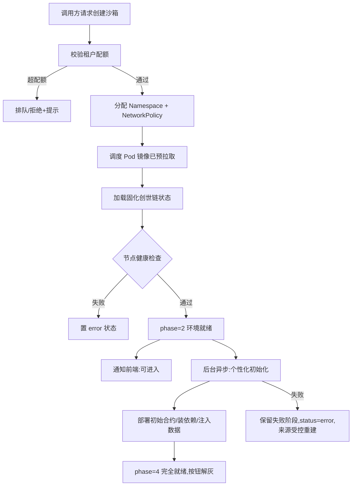
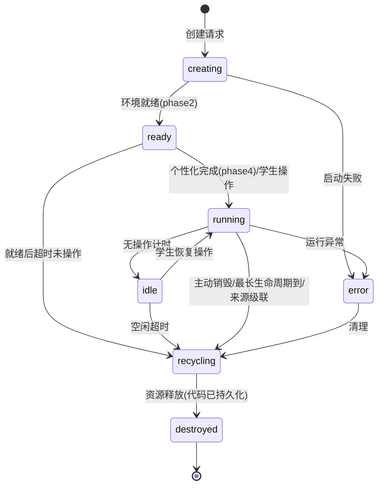
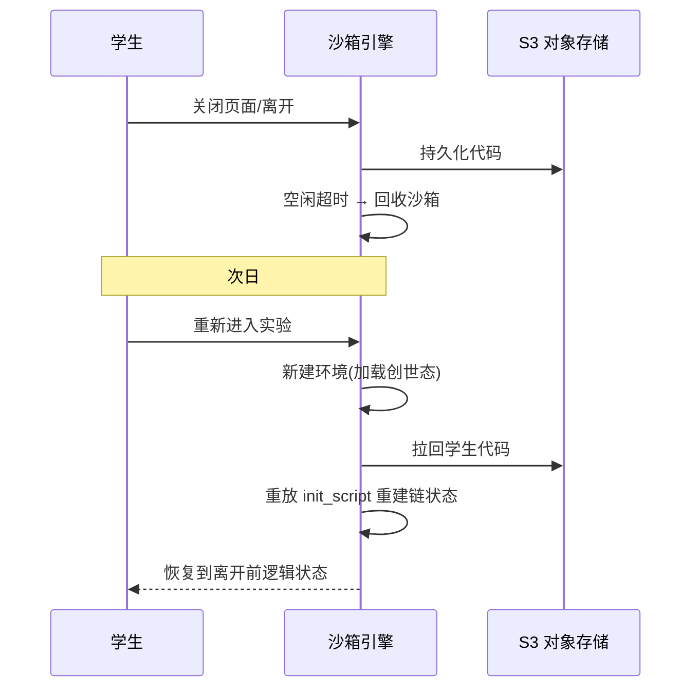
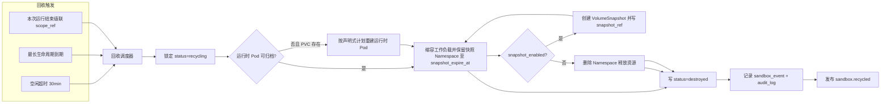
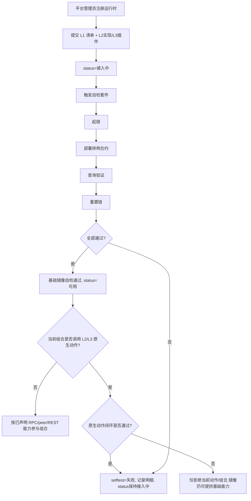
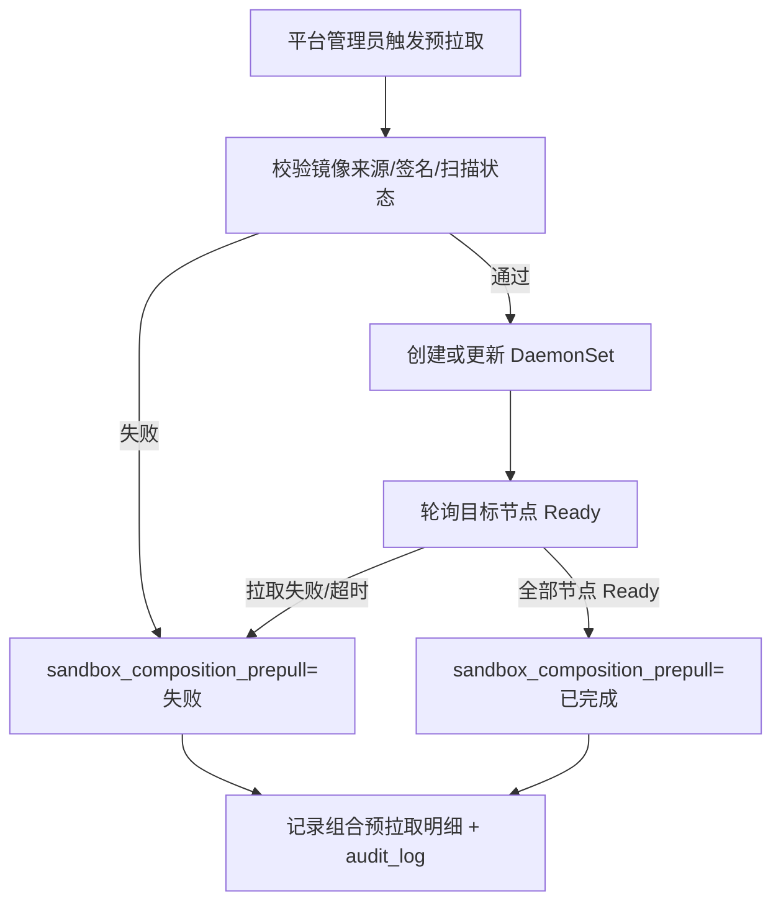
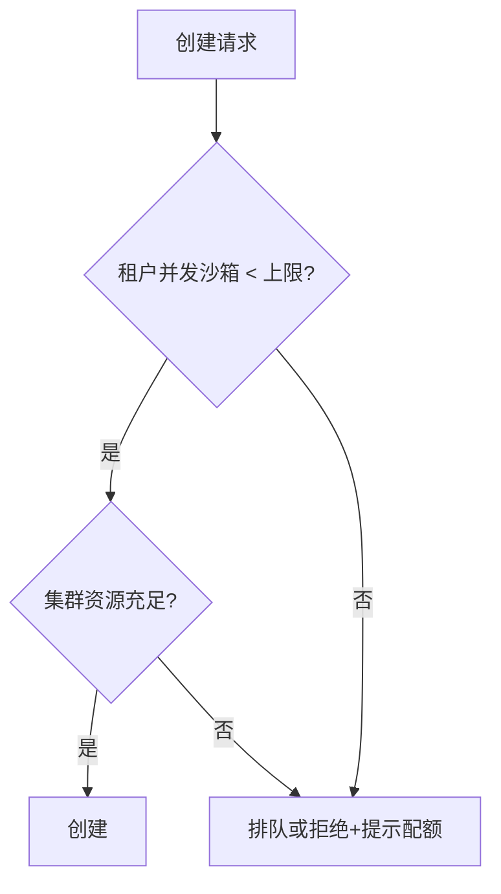

# M2 沙箱引擎 — 业务流程与状态机

> 用 Mermaid 描述沙箱启动、生命周期、回收、适配器接入流程。
> 最后更新:2026-08-23

---

## 1. 分阶段启动流程

阶段一(A→G,目标 ≤5s)完成即让学生进入;阶段二(I→K)后台补齐。需要个性化初始化的沙箱必须在 `phase=3` 完成前保持工作面不可操作,只有 `phase=4` 才能进入完整工作台;没有个性化初始化的沙箱在 `phase=2` 可进入。
有初始化任务时,基础环境准备完成直接发布 `phase=3`,不暴露短暂可执行的 `phase=2`;生命周期仍经 `ready` 进入 `running`,阶段与生命周期共同决定操作权限。文件、终端、链操作、判题等待及提交门禁只接受 `phase=2/4` 且 `status=ready/running/idle`,不以阶段数值大小判断就绪。暂停、回收中、已销毁、失败和初始化中均不可操作。
异步启动推进与通用状态流转须在同一事务内先取得沙箱权威行锁,再校验当前状态、更新并记录事件；该锁与文件保存/归档及回收更新共用同一沙箱行。回收先提交时,迟到启动停止推进且不写事件；启动先取得锁时,回收等待该短事务完成后接管,不能用锁前旧状态覆盖回收中或已销毁终态。
首次启动、暂停恢复和快照恢复均须在开放 `phase=2/4` 前,由非学生目标执行 `workspace_ops.clean_workspace` 清除根平台脚本副本;清理失败不得开放文件、终端或工具。创建依赖校验与恢复入口须先校验私有脚本目标和命令,缺少声明的历史组合明确不可启动,保留业务记录/代码/快照供正常新发布流程使用,不以学生入口回退执行。
工具准备独立于沙箱阶段推进,网页工具和受控命令工具还必须以 `tool_access[].status=ready` 为操作前置。工具仍在启动时,工作台继续重读同一沙箱详情并展示准备状态,不提前换取浏览器票据、创建 iframe 或执行命令;失败时明确提示并允许重新读取权威状态。实验与竞赛复用同一工作台规则,不以沙箱已就绪替代工具已就绪。
同一沙箱的工具并行探测后必须汇总全部失败,各失败均保留工具标识、原探测原因和失败状态写回原因;不得只返回第一项或用写回错误覆盖探测错误。等待结束时保留最后一次独立探测失败及上下文取消/超时原因,由内部日志展开完整错误链,不向学生暴露技术细节。探测间隔使用已有有效配置,无效配置显式报错,不另设硬编码默认值。
资源编排以 `CreateSandboxResources` 的幂等创建和规格核对为唯一启动路径:创建 Namespace 和该沙箱专属 RBAC 后再读取资源,不在首次创建前做 Pod 就绪探测,也不以探测异常作为替代创建的 fallback。阶段一及阶段二任一步失败统一保留失败阶段、进入 `error`，记录错误事件并发布带 `tenant_id`、`sandbox_id`、`source_ref`、`scope_ref` 和 `trace_id` 的 `sandbox.failed`，供来源模块对账及受控回收。终态写入与事件使用独立有界上下文，不被原执行超时取消。失败不开放工作面，也不自动重放未证明幂等的初始化脚本；由原来源的重建入口保存已持久化代码与进度、回收旧计算资源，再创建新环境。

---

## 2. 沙箱状态机

- **ready 态超时回收**(B6 修复):就绪后长时间未操作(如 10min)直接回收,防止就绪沙箱僵尸占用。
- **回收事件通知来源**(A4 修复):沙箱进入 `recycling`(任何触发:空闲/最长生命周期/就绪超时)时,**发布 `sandbox.recycled` 事件**(经事件总线,携带稳定 `source_ref` 和本次 `scope_ref`),来源方(experiment/contest)订阅后同步更新自身实例状态,避免上游仍持 `sandbox_ref` 而沙箱已销毁的悬挂。上游恢复(resume)前应探活,已销毁则按原组合快照 digest 触发重建(代码已持久化 + 重放部署脚本)。用事件而非反向接口调用,避免 sandbox 反向依赖业务层(见工程目录设计 §3.1.1)。

- 进入 `recycling` 前确保学生代码已持久化到 S3 对象存储。
- `keep_alive=true` 的沙箱:`idle` 不触发空闲回收,但仍受 `keep_alive_until`、`expire_at`、租户并发与资源配额约束。
- 来源模块核对回收终态只读取持久化生命周期和冻结组合身份，不受当前目录自检状态影响。冻结组合须重新计算摘要并与组合声明及沙箱记录同时相等；读到终态不能绕过新建、恢复、学生交互或归档重建的当前准入校验。

---

## 3. 断点续做(默认重建)

---

## 4. 回收流程(三重保证)

回收失败处理:
- 运行时 Pod 已终止但工作区 PVC 仍存在:使用原运行时计划和已验签镜像重建 Pod、重新挂载 PVC 后保存;重建失败时保留 Namespace 和 PVC 等待重试,不得跳过最终保存。
- 持久化失败:保留 Namespace,写 `error`,等待重试或人工处理。
- 快照成功:由于 CSI `VolumeSnapshot` 是 namespaced 资源,不得立即删除所在 Namespace;必须先缩容/删除计算工作负载释放 CPU/内存,保留 PVC/VolumeSnapshot/Namespace 至 `snapshot_expire_at`,由过期清理任务删除。
- 快照失败:若调用方要求保留运行态,保留 Namespace 并写 `error`;若只是普通回收且未要求快照,按默认重建策略继续删除。
- K8s 删除失败:保持 `recycling`,由调度器重试,不得写 `destroyed`。

---

## 5. 运行时接入即测流程

基础镜像自检通过的运行时即可对组合调用方提供 manifest 声明的 RPC、peer、REST 等基础能力;L1 只在组合实际调用未声明的原生动作时拒绝该动作,不能把整个镜像标成接入中或从目录隐藏。原生动作闭环单独记录为动作能力状态,不改变基础镜像准入状态。每次自检启动时必须在事务内锁定待测运行时镜像和当前能力证明,生成唯一 `attempt_id`,并把本批次自检标记为进行中;完成时仅允许批次一致的结果写回。并发修改执行契约、停用运行时或后发自检会使旧批次自然失效,旧结果不得恢复过期配置的能力状态。自检启动后即使发起端断开,服务端也必须在有界上下文内完成资源清理和条件状态回写。

运行时接入自检与判题器平台组合自检都以执行完成且临时资源回收完成作为成功条件。执行预算结束不得写成通过;回收使用脱离发起请求的独立配置预算,回收失败必须合并到本次结果。运行时仅回收失败时明细复用 `stage=recycle` 的“回收环境”语义,执行和回收同时失败时保留两条内部错误链,界面只返回失败状态、阶段和报障编号。沿用原尝试标识条件写回,不以清理异常重新发起自检或恢复已失效的结果。

### 5.1 多镜像交互验证

组合内镜像默认相互隔离,不会因为同属一个实验或竞赛环境而自动共享状态。只有已发布快照中的 `links`、编译生成的 Service/DNS 与环境绑定、显式 NetworkPolicy,或经校验的共享卷安全域,才构成可执行的交互路径。测试必须覆盖“源组件执行动作 -> 目标组件通过自身协议观察到状态变化 -> 断开未声明连接仍被拒绝”三步;只验证两个 Pod 都为 Ready 不算交互通过。

网络交互使用目标组件真实端点和协议,例如 Blockscout 必须经组合绑定的 EVM RPC 查询运行时,Fabric Explorer 必须经 peer/orderer 端点和只读 `runtime-state` 读取身份。工作区文件共享与链运行态共享是两个不同安全域;写入 `workspace` 不会自动改变 `runtime-state`,写入链状态也不会自动出现在学生文件接口。首次创建和快照恢复都必须先建立 Service,再按 `required_at_start` 拓扑创建并等待 Pod,避免消费者先于目标服务获得可解析地址。

## 6. 镜像预拉取流程

预拉取完成以 Kubernetes 节点实际 Ready 状态为准,不能以接口调用成功或 DB 更新作为成功。控制器必须已观察当前 DaemonSet generation,且全部目标节点同时达到 updated、ready、available,没有 unavailable 或 misscheduled 节点;旧模板残留的 Ready 数字不能放行。预拉取集合是目标 `CompositionSpec` 发布快照的完整镜像闭包,不是按运行时默认工具或生态标签批量生成的集合。只有组合快照 digest、镜像、自检命令、常驻用途、临时目录、能力约束或安全策略变化时,受影响快照才失效;改名称等展示字段不触发无意义重拉。运行时其他实际执行契约变化仍必须重置接入自检。

所有触发入口在同一镜像行锁的短事务内认领 `(runtime_image_id, composition_digest)` 尝试。仍在 `SANDBOX_PREPULL_TIMEOUT_SECONDS + SANDBOX_READY_TIMEOUT_SECONDS` 总预算内的进行中尝试统一复用,后发请求不能覆盖其 `attempt_id`。执行者在事务外按前者预算等待 Kubernetes,再用后者独立预算持久化终态和审计;加入者沿既有轮询间隔查询同一持久化尝试,只有真实成功才向判题自检等调用者返回成功。调用者取消不取消原执行者,等待超时、失败、删除或尝试失效均显式返回错误。只有终态、已失效或超过总预算的记录可认领新尝试;保留完成写回的 attempt CAS,旧结果不能覆盖新状态。不增加内存锁、长期事务或第二协调器。

失效只阻断新编排与新沙箱,不修改已创建沙箱绑定的不可变镜像;平台管理员重新触发预拉取后,同名 DaemonSet 以最新闭包更新并重新等待全部节点 Ready。预拉取一旦写入进行中,即使发起端断开也必须继续在服务端有界等待并写回最终结果。冷节点必须给完整闭包的拉取与自检保留 900 秒基线窗口;已有 digest 缓存时仍走同一状态机,由 `IfNotPresent` 避免重复下载。

---

## 7. 配额与排队

