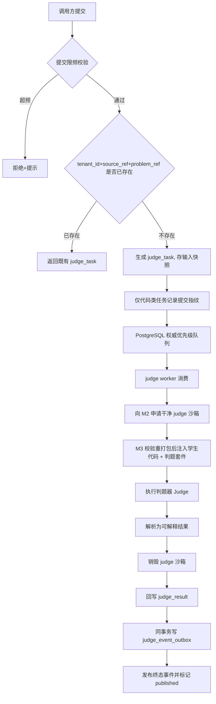
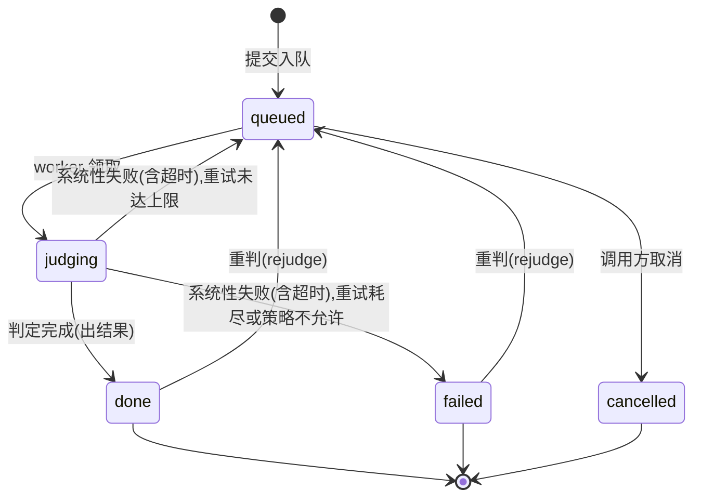
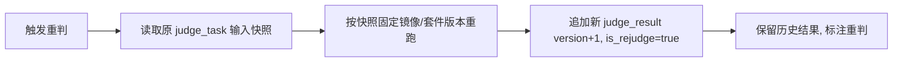
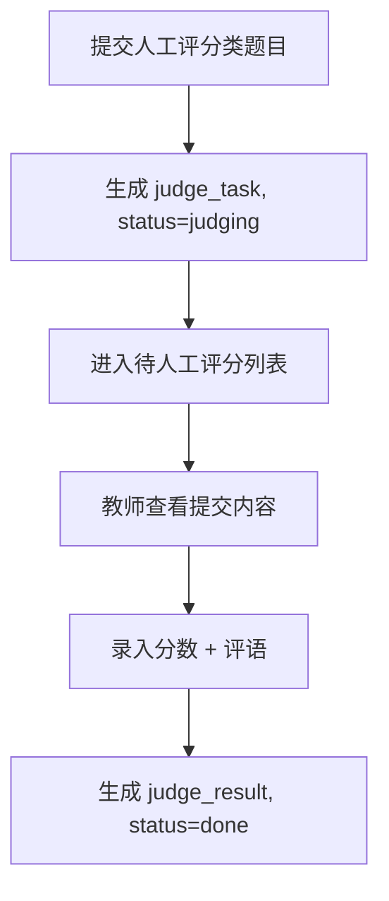
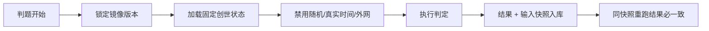

# M3 评测引擎 — 业务流程与状态机

> Mermaid 描述判题流程、任务状态机、重判与人工评分流程。
> 最后更新:2026-11-27

---

## 1. 异步判题流程

调用方必须为同一次业务提交传入稳定 `source_ref` 与 `problem_ref`。提交接口以 `(tenant_id, source_ref, problem_ref)` 作为幂等键：同一次提交重复投递只返回既有任务。M7 每次学生判分生成独立的 `experiment:<year>:judge:<instance_id>-<submission_id>-<checkpoint_id>`，评测本次输入；实例资源仍使用稳定实例来源，reuse 通过 `sandbox_source_ref` 单独传入。教师复核历史任务走 rejudge，保留原输入快照与审计链。

---

## 2. 判题任务状态机

- `done` 含通过与不通过,均为正常终态(代码错误不是 error)。
- 沙箱申请失败、判题器异常和执行超时均属于系统性失败;worker 在持有租约的同一 CAS 状态迁移中直接回队列或写失败终态,脱敏原因记录在 `last_error`,不持久化额外中间状态。
- **`failed` 为失败终态**:重试达上限或策略不允许重试时进入。进入 failed 时与状态更新同事务写入 `judge_event_outbox`,随后发布 `judge.failed` 事件(携带 task_id/source_ref/失败原因);调用方(teaching/experiment/contest)订阅后进入各自异常分支(如提交标记"判题失败可重试"、实例检查点标记异常),不再无限等待。用事件而非反向接口调用,避免 judge 反向依赖业务层(见工程目录设计 §3.1.1)。事件发布失败不得回滚已完成/已失败的判题终态,只能保留 outbox 待重试;单条 outbox 发布失败会记录 `next_attempt_at` 退避,worker 继续处理后续事件,避免 poison/stuck 记录永久阻塞。
- 私有对局不在已改变的沙箱上重试或原地重判；人工评分不领取自动 worker 租约。具体执行模式见[接口设计](03-接口设计.md#32-两种判题沙箱模式)。

---

## 3. 重判流程(原输入复核)

- 单条重判:申诉场景。
- 批量重判按已授权 `source_ref` 集合复核历史输入，不将题目新版本或当前默认配置替换进原快照。
- 任务提交、取消、重判、人工评分及判题器管理状态落库时,状态变更与 M1 `audit_log` 写入在同一事务中提交;审计失败则业务状态回滚。自检执行在事务外运行,其最终状态与审计原子提交。

---

## 4. 人工评分流程(J6)

人工评分不进 judge 沙箱、不自动执行,由教师产出结果。
人工评分接口必须校验任务 `source_owner_id`/提交者归属,普通教师不能按租户范围横向评分其他教师或其他来源任务。

---

## 5. 确定性保障流程

