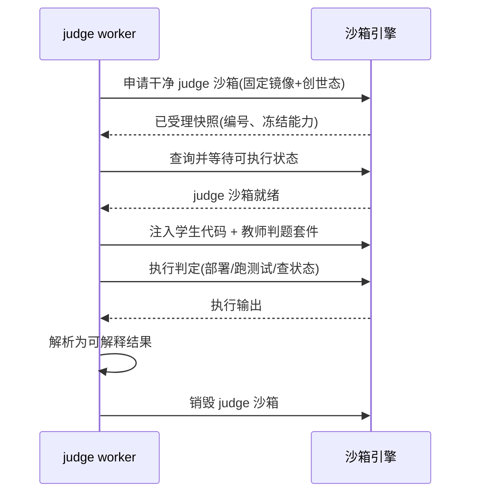

# M3 评测引擎 — 架构设计

> 核心:判题器插件框架、judge 专用沙箱、异步判题队列、确定性与可解释结果。
> 最后更新:2026-11-28

---

## 1. 总体架构

```
┌──────────────────────────────────────────────────┐
│  调用方:M7 实验 / M8 竞赛 / M6 作业                  │
│  提交(内容 + 判题配置 + 来源标识)                    │
└─────────────────────┬────────────────────────────┘
                      │ POST /judge
┌─────────────────────▼────────────────────────────┐
│  M3 评测引擎(Go)                                   │
│  ┌─────────┬──────────┬──────────┬─────────────┐ │
│  │ 提交接收 │ 判题队列  │ 判题器    │ 结果回写     │ │
│  │ +限频   │(优先级)  │ 调度器    │ +可解释      │ │
│  └────┬────┴────┬─────┴────┬─────┴─────────────┘ │
└───────┼─────────┼──────────┼───────────────────────┘
        │         │          │ 申请 judge 沙箱
        │         │   ┌──────▼──────────────────────┐
        │         │   │ M2 沙箱引擎(干净判题沙箱)     │
        │         │   │ 注入:学生代码 + 判题套件      │
        │         │   │ 跑判定 → 产出结果 → 立即销毁   │
        │         │   └─────────────────────────────┘
        │    ┌────▼─────┐
        │    │ judge    │ ← 横向扩展的判题 worker
        │    │ worker x N│
        │    └──────────┘
```

---

## 2. 判题器插件框架

### 2.1 统一输入与结果

M3 从 M5 锁定版本读取判定依据，并与本次输入冻结为私有快照。worker 按判题类型选择后端策略或受控沙箱命令；所有自动策略返回统一结果，包含通过与否、分数、满分及可解释详情。容器执行器按固定命令输出结构化 JSON，接入通过注册配置和自检完成；新增后端判定语义需在 M3 实现并验证策略。

### 2.2 七类判题器

| 判题器 | 执行方式 | 是否起链沙箱 |
| --- | --- | --- |
| J1 测试用例 | 沙箱内跑测试套件,解析通过数 | 是 |
| J2 链上断言 | 部署合约→执行断言→比对链上状态 | 是 |
| J3 Flag | 比对静态/HMAC/链上 flag | 部分 |
| J4 静态检查 | 隔离环境内运行受控扫描命令 | 是，不要求起链 |
| J5 仿真检查点 | 比较上层提交的检查点快照与锁定期望 | 否，不直接依赖 M4 |
| J6 人工评分 | 教师录入,不自动执行 | 否 |
| J7 理论题 | 后端比较单选、多选、判断和填空答案，简答走人工评分 | 否 |

---

## 3. judge 专用沙箱(安全核心)



- fresh 模式使用独立 judge 沙箱，学生不能访问；reuse 模式保留调用方现场环境，只经 M2 受控能力执行判定，M3 不销毁该环境。
- 题目和判定依据由 M5 管理；M3 私有输入快照按题型保存所需依据。套件注入私有卷域，用户响应只含脱敏结果，不含答案或套件。
- fresh 判题结束后通过独立有界上下文请求销毁，由 M2 正式回收流程释放资源。

---

## 4. 确定性与可复现

- 固定完整 judge 环境快照 + 固定创世状态。平台管理员请求中的 `composition` 只是一次性声明输入,服务端必须交给 M2 以 `access_profile=judge-private` 编译；数据库 `judger.resource_spec` 只保存 M2 返回的完整 `composition_snapshot`，不得同时保存声明、单独 `composition_digest`、运行时、镜像版本、工具或默认镜像字段。M3 创建 fresh judge 沙箱时只使用该完整快照。
- `judger.resource_spec` 复用镜像层统一 WorkloadSpec 的资源、命令、探针、卷和安全字段语义。J1/J4 这类容器化判题器通常是单组件命令型工作负载,但仍必须显式声明命令、资源、超时、工作目录和输出契约;不得另造一套 M3 私有资源结构。
- 判题逻辑禁止依赖:随机数、真实时间、外部网络。
- 每次判题记录**输入快照**:`学生代码 hash + 判题套件版本 + 完整 composition_snapshot + 私有执行 sidecar 规格 + genesis_ref + 判题器版本`。私有 sidecar 由 M2 在同一 judge Pod 中创建，既不产生工具代理入口，也不进入学生可见面。
- M3 向 M2 转换私有 sidecar 时必须逐项保留 `mount_domains` 等 WorkloadSpec 安全声明并复制切片,不得丢失隐藏判题材料挂载域或让转换结果反向改写输入快照。
- 历史任务重判保留原提交快照；学生修改内容后再次判分创建独立提交，评测当前输入。

---

## 5. 异步判题队列

```
提交 → 限频校验 → 入队(优先级)→ worker 消费 → judge 沙箱判定 → 回写结果 → 通知调用方
```

- **优先级**:竞赛提交 > 实验提交 > 作业提交(可配)。
- **超时**:单次判题超时则终止并标记超时。沙箱就绪等待使用任务超时加启动宽限的独立 context，预算覆盖状态查询和轮询，截止后返回的就绪结果不能继续执行。等待预算耗尽归类为判题超时；父请求取消保留原取消原因。新建沙箱仍在独立有界清理上下文中回收。
- **重试**:系统性失败(沙箱申请失败等)按策略重试;判定失败(代码错误)不重试,直接出结果。
- **失败诊断**:执行失败在重试或终态落库前记录脱敏的完整错误链及租户、任务、trace；事件发布失败与失败标记落库错误分别记录。内部原因不写入用户向进度消息，状态写入失败也不得丢失原执行或发布原因。
- **扩展**:judge worker 无状态,按队列积压横向扩缩容。
- **任务租约**:`JUDGE_TASK_LEASE_DURATION_MS` 至少为 3000 毫秒。worker 按批领取任务，每个任务开始前先以当前租约令牌续租；已过期或已被其他 worker 领取的任务不执行。执行与续租收尾统一复用 [background.WithRenewal](../总-后端层能力索引.md#internalplatformbackground)，失去租约取消判题且不写原任务终态，执行退出须等待续租调用结束。fresh 判题沙箱的 `source_ref` 按任务租约生成独立执行键，原业务 `source_ref` 只作为 `scope_ref` 和判题幂等键，旧执行的回收不会触及重试环境。
- **终态事件可靠发布**:`judge.completed`/`judge.failed` 先写入 M3 自有 `judge_event_outbox`,再由 worker 按 `JUDGE_WORKER_BATCH_SIZE` 批量发布并标记 published。发布失败保留 failed/pending outbox,写入脱敏错误和 `next_attempt_at` 退避时间；本轮汇总全部发布、确认和失败回写错误，继续处理后续事件。未取消的 worker 不因积压事件投递失败而跳过任务领取，任务处理错误和前后两次投递错误一并返回；已完成任务不重新执行。人工评分的结果、终态事件和审计在同一事务提交后返回已保存结果；立即投递失败记录诊断并交给原 outbox 重试，不能把已提交评分报告为事务失败。

---

## 6. 可解释结果

结果结构不只含分数,还含逐项详情:

```json
{
  "passed": false,
  "score": 60,
  "max_score": 100,
  "details": [
    { "case": "转账后余额正确", "passed": true },
    { "case": "超额转账应 revert", "passed": false,
      "expected_label": "应拒绝超额转账", "actual": "转账成功", "hint": "缺少余额校验" }
  ],
  "result_ref": "judge:2026:result:8801",
  "replay": {"actions": [{"seq": 1, "op": "tx", "payload": {}, "output": {}}]}
}
```

服务教学(学生知道错在哪)+ 申诉(有据可查)。

---

## 7. 多租户

- 判题任务带 `tenant_id`;judge 沙箱经 M2 按租户隔离。
- 判题器定义为平台级配置;判题任务/结果为租户级数据(RLS)。

## 8. 跨模块依赖口径

- M3 只通过 `internal/contracts.SandboxService` 调 M2 创建/回收 judge 沙箱、注入代码/套件、执行受限判题命令和调用链上能力,禁止 import `internal/modules/sandbox`。
- M3 调 M2 执行命令仅限 judge worker 内部使用:命令来自平台级 `judger.resource_spec.command`,运行型判题器固定完整 `composition_snapshot`、私有 sidecar、`genesis_ref`、`command` 和重试/超时策略;工作目录为沙箱工作区,必须带超时,stdout/stderr 只用于解析判题结果和写日志,不得向学生暴露完整测试套件输出。M3 不保存或生成第二套 WorkloadSpec。
- M3 不生成 Kubernetes Pod/Service/NetworkPolicy；链判定和容器命令均经 M2 隔离执行。静态扫描不要求起链，仍使用已冻结组合及同一资源和输出契约，不复制编排器。
- M3 worker 与查重能力的通用运行边界必须来自统一环境配置:`JUDGE_RESULT_DETAILS_MAX_BYTES` 限制 `details` JSON 最大字节数,`JUDGE_INPUT_TIMEOUT_SECONDS` 限制判题输入对象存储和代码/套件注入请求,`JUDGE_INPUT_ARCHIVE_MAX_FILES` 与 `JUDGE_INPUT_ARCHIVE_MAX_UNPACKED_BYTES` 限制学生提交/判题套件归档的文件数和展开大小,`JUDGE_SIMILARITY_DEFAULT_THRESHOLD` 控制查重相似度默认命中阈值;不得在 worker 或 service 内硬编码阈值。
- M3 注入学生提交和判题套件前必须在后端校验并重打归档,拒绝绝对路径、`..`、Windows 盘符、重复条目、软/硬链接和特殊文件。不得把对象存储中的 tar/zip 直接交给 judge 沙箱内 `tar` 解包,防止学生提交覆盖套件目录或逃逸工作区。
- M3 只通过 `internal/contracts.ContentJudgeService` 调 M5 读取题目锁定版本的判题配置、答案、flag 与套件引用;M3 不保存题目正本,调用方也不得把答案经 HTTP 传给 M3。
- J5 仿真检查点由 M7/M4 在上层编排产生检查点输入快照后提交 M3;M3 不直接依赖 M4,避免同层引擎互相调用。
- 判题完成发布 `judge.completed`;系统性失败重试耗尽发布 `judge.failed`;调用方订阅事件处理业务状态,避免 M3 反向调用 M6/M7/M8。
