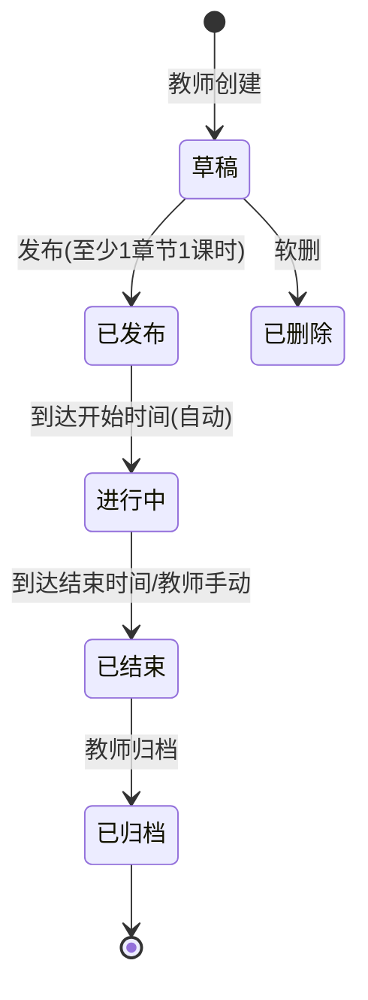
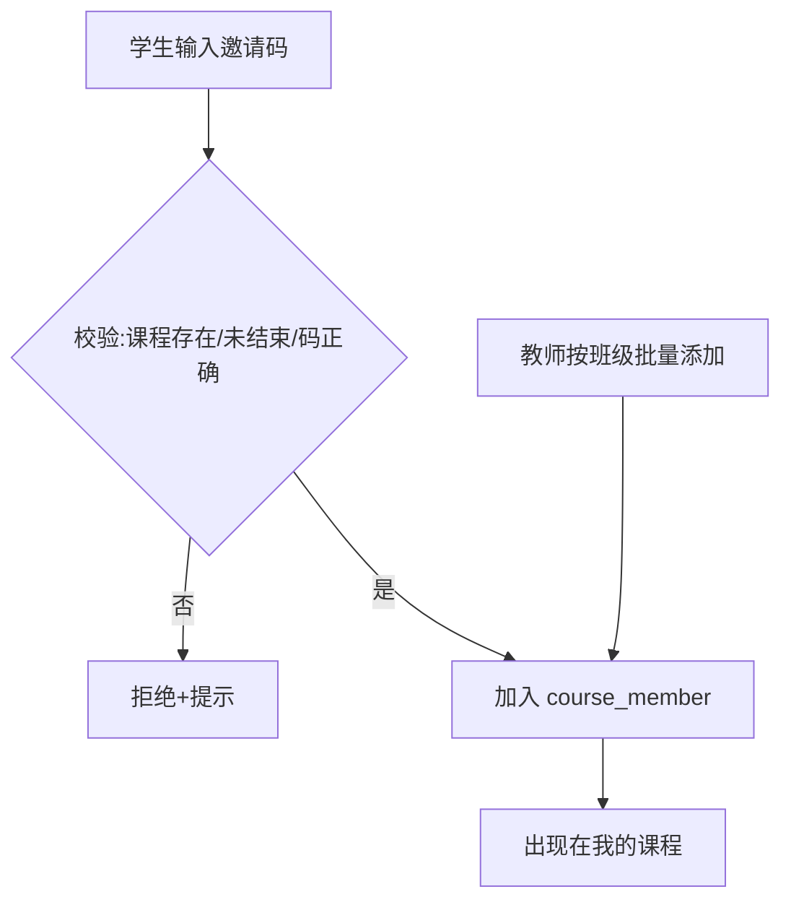
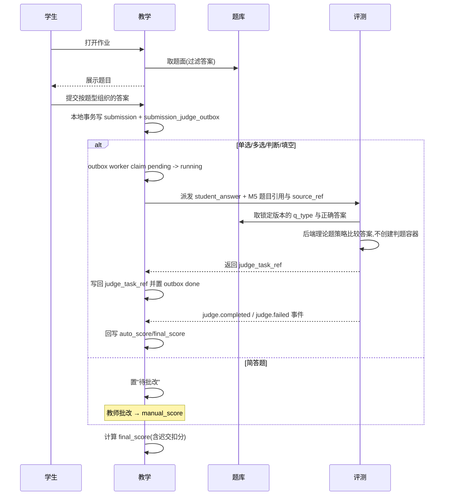
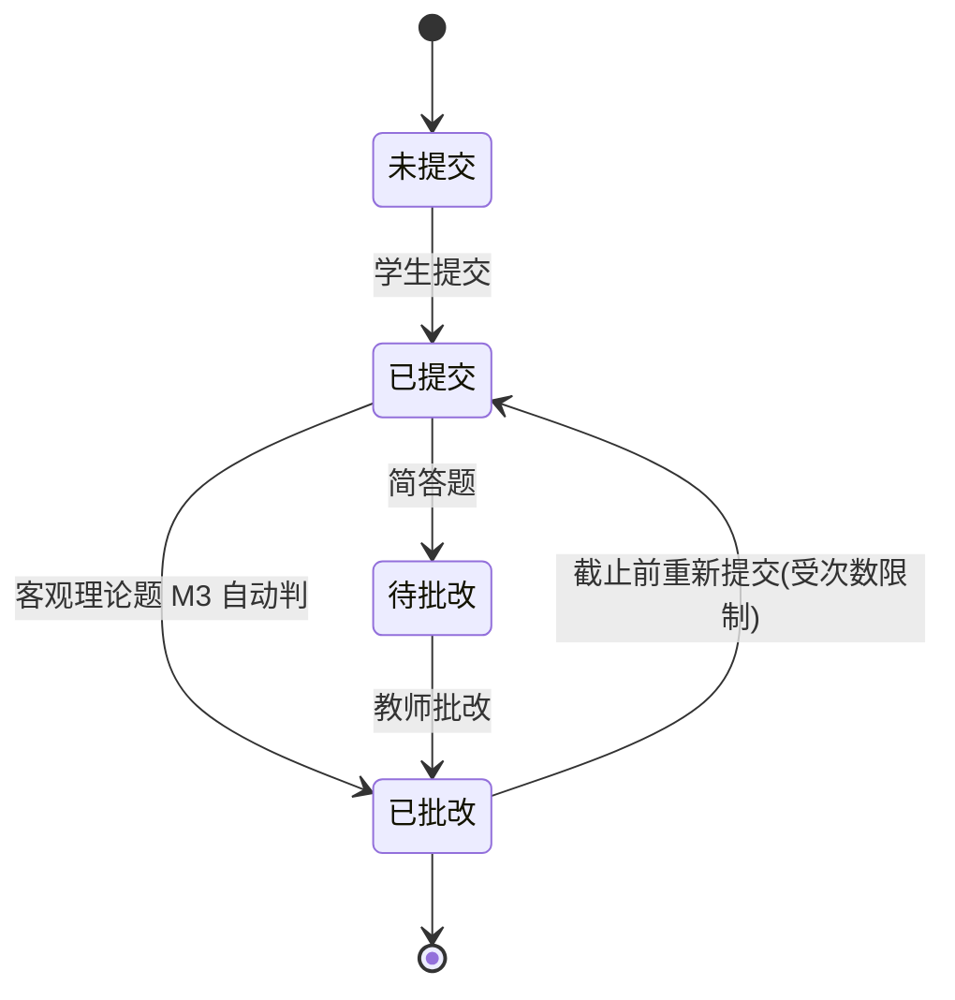
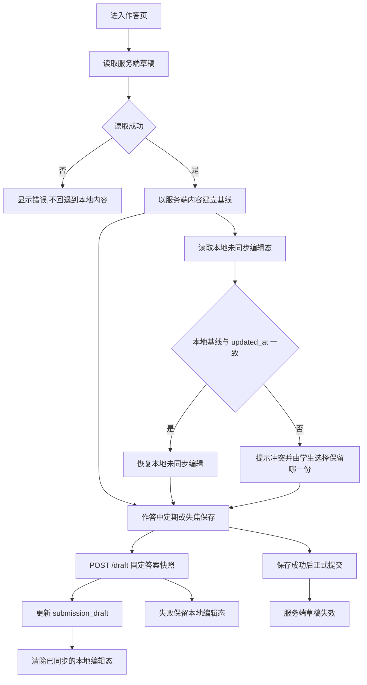
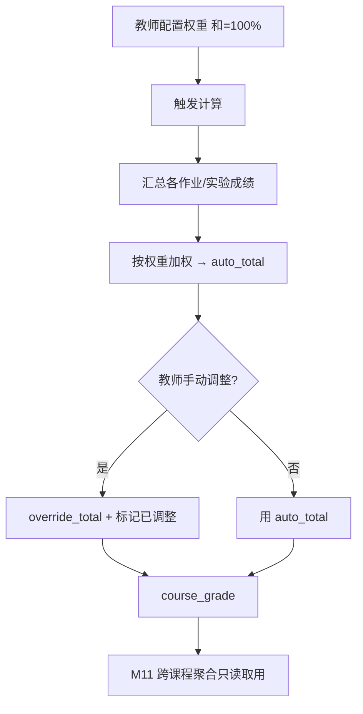
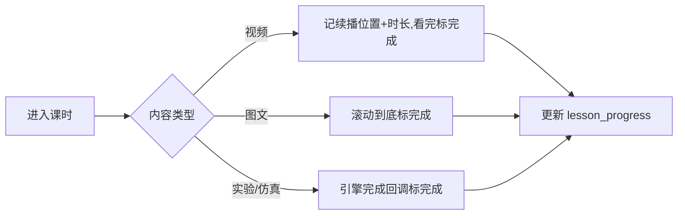

# M6 教学 — 业务流程与状态机

> Mermaid 描述课程生命周期、作业提交批改、学习进度、单课程成绩计算。
> 最后更新:2026-05-29

---

## 1. 课程状态机

- 已发布/进行中可编辑内容,但不能删已有提交的作业。
- 学生名单管理仅在已发布/进行中。
- 自动状态推进由 M6 后台任务完成,轮询间隔由 `TEACHING_COURSE_STATUS_POLL_INTERVAL_SECONDS` 配置,启动时必须为正数。

---

## 2. 学生加入课程

---

## 3. 作业提交与判题(跨模块协作)

> 自动判题派发使用 M6 本地 outbox。请求事务只写 M6 自有表,不直接调用 M3;outbox worker 将 pending 任务声明为 running 后派发。M6 只传递学生答案和锁定题目引用,M3 读取 M5 黑盒答案并使用后端理论题策略判分,不创建判题容器。派发成功写回 `submission.judge_task_ref` 并将 outbox 置为 done;派发失败恢复 pending、递增重试次数并记录 `last_error` 供运维排查,达到 `ASYNC_OUTBOX_MAX_ATTEMPTS` 后进入失败终态 4,不再无限重试。M6 对一次提交内每道自动题生成一条 outbox,使用 `source_ref = teaching:<year>:submission:<id>:item:<assignment_item_id>`,M3 对 `(tenant_id, source_ref, problem_ref)` 幂等,保证 outbox 重试不会重复创建判题任务。M6 收到 `judge.completed` 后回写该 outbox 的 `score/completed_at`;收到 M3 失败终态则写入 `completed_at`、保留诊断原因并按 0 分结算。只有派发耗尽的状态 4 阻止自动结算;其余全部自动题终态到齐后聚合写回 `submission.auto_score/final_score` 并发布 `teaching.grade.updated`。outbox 每轮批量和后台轮询间隔分别由 `TEACHING_JUDGE_OUTBOX_BATCH_SIZE`、`TEACHING_JUDGE_OUTBOX_POLL_INTERVAL_MS` 控制,启动时必须为正数。
---

## 4. 作业提交状态机

> 截止后提交标记迟交;按迟交策略处理。

---

## 5. 作答草稿

> 服务端 `submission_draft` 是作答草稿权威状态。本机只暂存带 `student_id`、`assignment_id` 和服务端 `updated_at` 基线的未同步编辑态;恢复前必须先成功读取服务端草稿。基线不一致时保留双方内容并提示冲突,保存失败时保留本机未同步内容;正式提交前必须先把当前快照成功写入服务端。登录凭证不进入本机缓存。

---

## 6. 单课程成绩计算

> 成绩导出必须使用真实 Excel 工作簿并分批读取 `course_grade`;导出分页批量由 `TEACHING_GRADE_EXPORT_BATCH_SIZE` 控制,启动时必须为正数,避免在模块代码中硬编码运行阈值。M6 在自有导出请求表持久化 `course_id` 和发起账号,不复制 transfer 状态、不把导出状态写入 `course_grade`;M6 worker 依次领取平台 transfer 任务、生成 xlsx、写入统一文件服务并完成或失败任务。生成的 xlsx 只作为产物登记到基础横切层 `transfer_task`。

---

## 7. 课时学习进度

