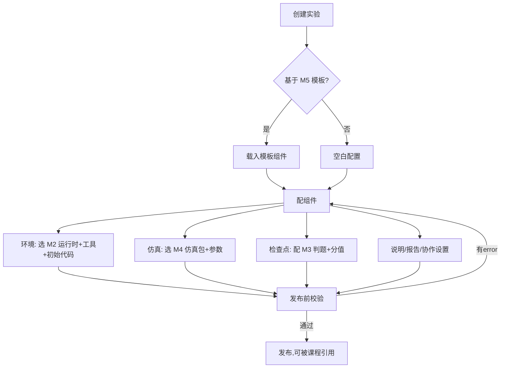
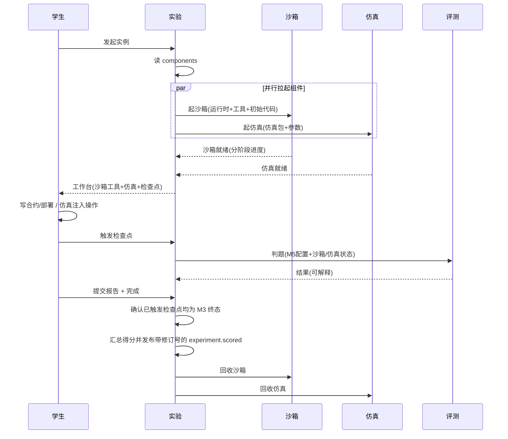
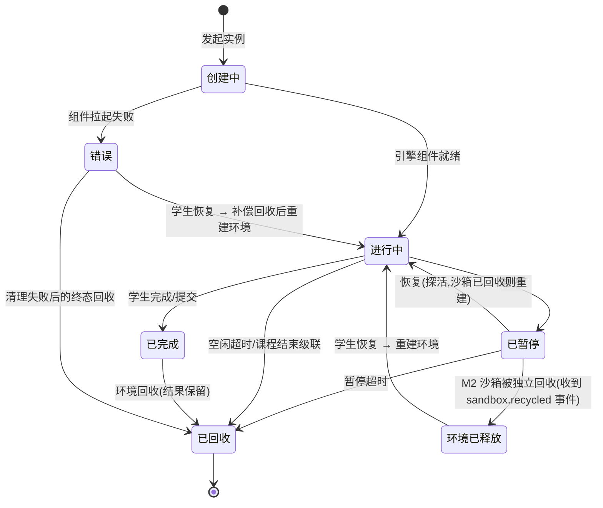
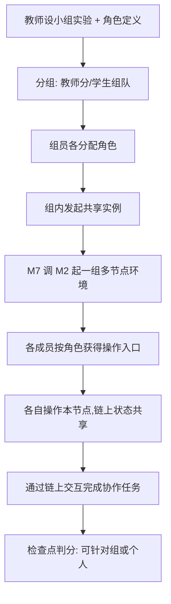
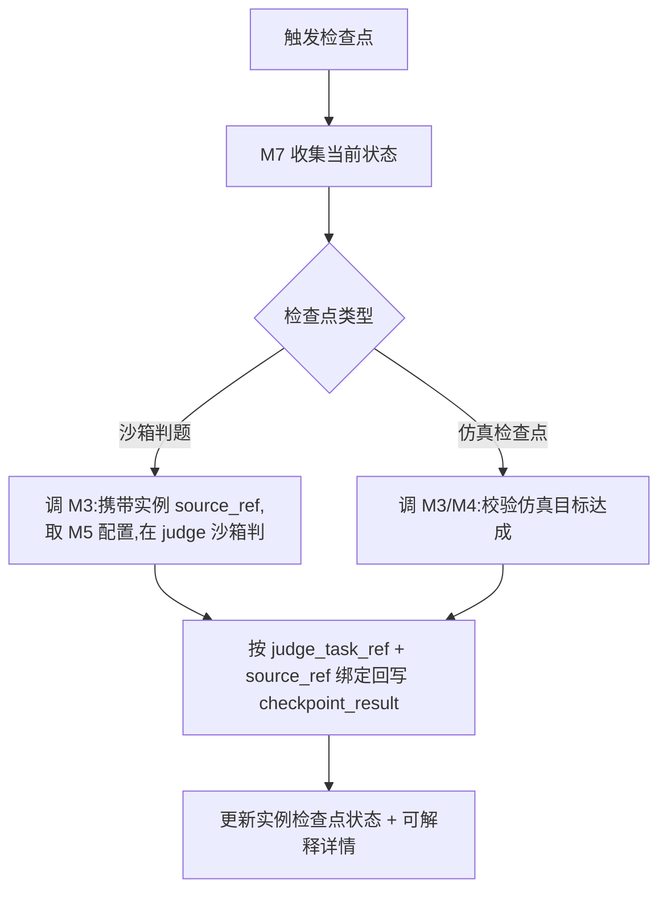
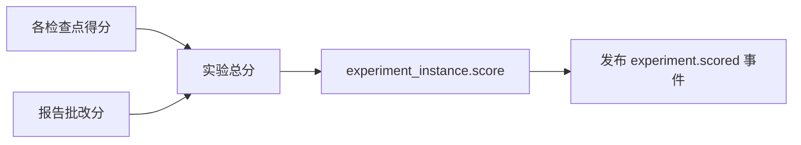

# M7 实验 — 业务流程与状态机

> Mermaid 描述实验配置发布、学生做实验编排、实例状态机、多人协作、检查点判分。
> 最后更新:2026-08-23

---

## 1. 教师配置实验(向导式)

向导的“保存草稿”只持久化当前编辑内容和所在步骤,不得因当前步骤尚未完整而阻止保存;这是跨刷新/关闭重开的服务端草稿,不是发布有效性声明。只有“保存并进入下一步”才执行当前步骤的必填校验,发布前校验/正式发布再执行完整结构、依赖和成绩契约校验。服务端仍校验持久化数据的字段格式、组件 ID、引用关系和安全边界,不接受非法结构。

---

## 2. 学生做实验编排流程

> 发布前校验包含结构、分值、M5 锁定版本和每个环境 `CompositionSpec` 编译校验;M5 内容读取或 M2 编译契约不可用时校验结果必须包含阻断发布问题,不得使用默认工具或默认镜像继续发布。实例创建时生成并持久化稳定 `experiment_instance.source_ref` 与本次运行 `scope_ref`;M2/M4 创建、恢复重建和 M3 检查点判题使用 `source_ref` 做归属绑定,回收和错误补偿使用 `scope_ref`。若任一引擎创建失败,M7 将实例置为错误态并按该 `scope_ref` 补偿回收已成功创建的组件。

> 完成实例时,M7 必须逐个确认已触发检查点对应的 M3 任务已进入终态;存在 queued/judging 任务则返回 `74008`,学生刷新后重试完成。得分与 `experiment.scored` outbox 在同一事务提交后,完成接口的重试只续跑 M2/M4 回收,不得重复汇总或重复生成得分事件;已回收实例直接幂等返回。检查点或报告的终态回写若改变已完成实例的总分,在同一实例锁内生成递增 `score_revision` 的 `experiment.scored` outbox 事件;事件重投不会生成重复修订,通知消费者以稳定事件 ID 幂等。

---

## 3. 实验实例状态机

- 回收只释放引擎资源(M2/M4),实验结果(检查点/报告/得分)保留。
- **操作状态以权威状态源为准**:检查点判分仅允许实例处于 `running` 或 `paused`;实例当前阶段引用 M2 沙箱时,页面还须读取该阶段沙箱实时状态,只有沙箱处于 `ready` 阶段且状态允许进入工作区时才开放判分。暂停仅允许实例处于 `running`,并须逐一确认当前实例引用的 M2 沙箱已到 `ready` 阶段且状态允许暂停。`SandboxRef.tools` 是创建时的工具接入摘要,不得作为沙箱生命周期或判分/暂停按钮的判断依据;服务端仍须通过 M2 保存工作区并校验沙箱归属与执行状态。
- **完成回收补偿**:得分已落库但同步回收失败时,实例保留在已完成态。M2 的可靠 `sandbox.recycled` 事件只有在确认该实例全部沙箱均已销毁后,才续跑 M4 回收并推进已回收态;学生重试完成接口也执行同一幂等续跑。单个组件的回收事件不得提前代表整实例已经回收。
- **断点续做与生命周期同步**(A4 修复):M2 沙箱被独立回收时发布 `sandbox.recycled` 事件,experiment 订阅后将实例转"环境已释放"(逻辑态,持有代码持久化引用);学生恢复时 experiment 使用稳定 `source_ref`、原组合快照 digest 和新的 `scope_ref` 重建环境(M2 拉回代码 + 重放部署脚本)再进入"进行中"。避免持失效 sandbox_ref 或跨年重算来源引用。用事件解耦,sandbox 不反向依赖 experiment(见工程目录设计 §3.1.1)。
- **暂停超时回收**:已暂停长时间不恢复则回收,防僵尸。
- **错误态补偿回收**(B7 修复):组件部分拉起失败(如 M2 成功但 M4 失败)时,错误态清理需**补偿回收已成功起的另一组件**(调 M2/M4 回收),不残留半截资源。
- **异步阶段一失败对账**:M2 阶段一启动失败后发布 `sandbox.failed`;M7 按稳定 `source_ref` 找到实例,按失败沙箱所属 `scope_ref` 补偿回收全部已创建引擎资源,再写入 `error`。事件投递存在时间差时,实例工作台和教师监控读取 M2 权威沙箱状态执行同一对账,不得让实例永久停留在 `creating/running`。
- **错误态恢复**:错误实例不承载学生可操作工作面,但不是结果终态。学生点击「重建实验环境」后,M7 先确认旧作用域已回收,再复用已保存的公开工作区归档、生成新的 `scope_ref` 并重新编排;重建失败保持 `error`,允许用户在同一实例上重试。
- **契约缺失显式失败**:实例已有沙箱或仿真引用时,手动回收必须要求对应 M2/M4 契约可用;缺契约不能视为回收成功,避免引擎资源实际残留。

---

## 4. 多人协作流程

> 不做实时协同编辑;协作通过共享链状态实现。

---

## 5. 检查点判分流程

---

## 6. 得分汇总与事件发布

