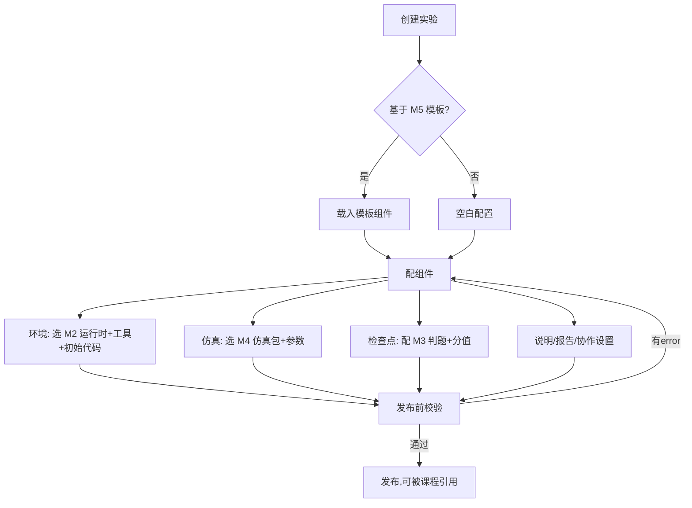
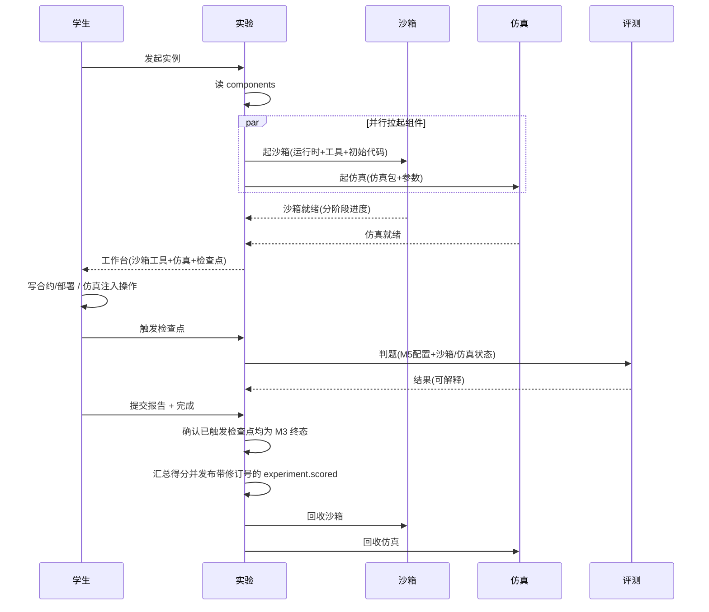
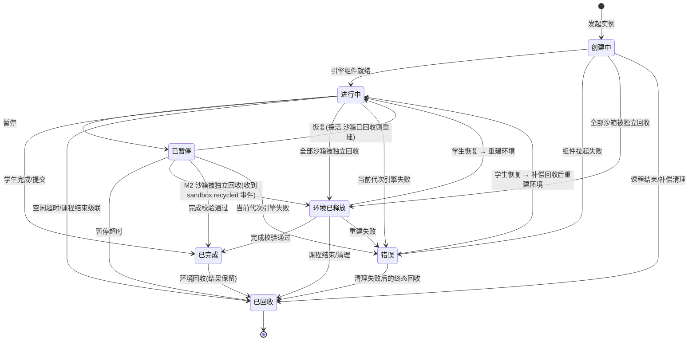
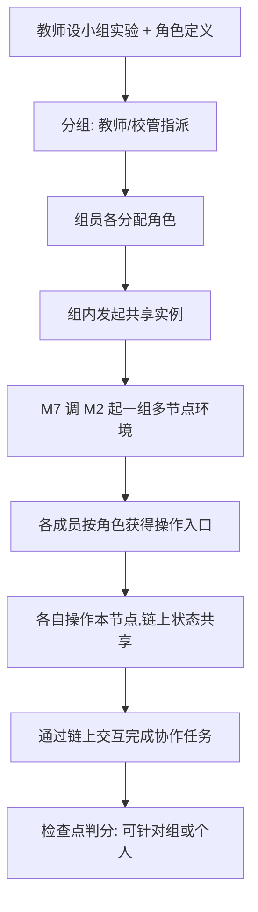
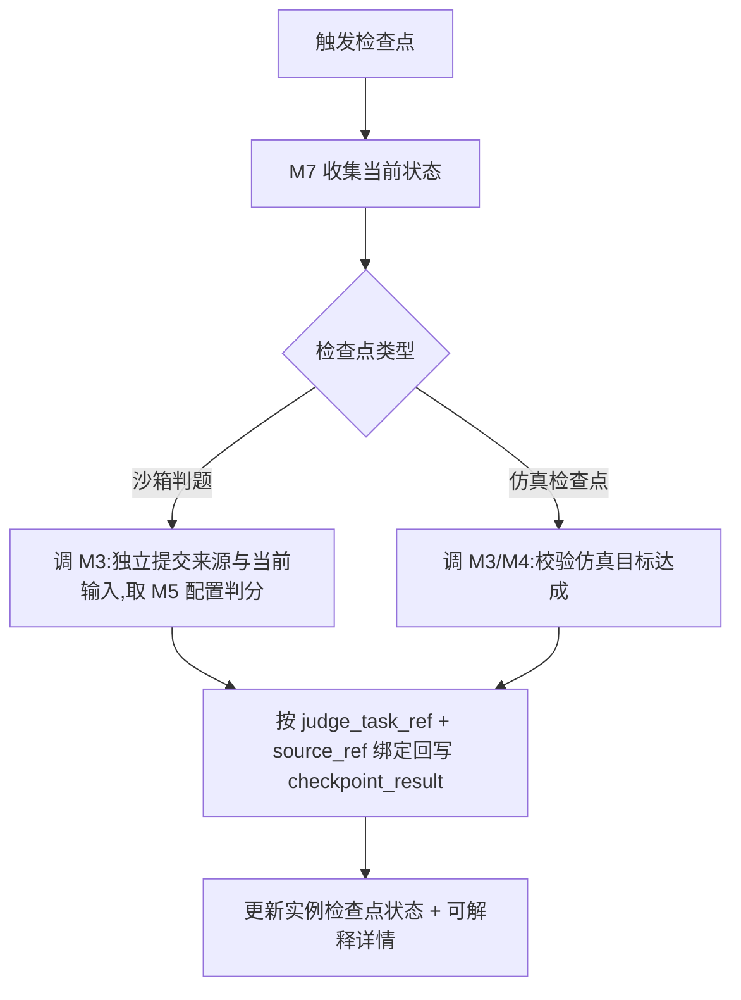
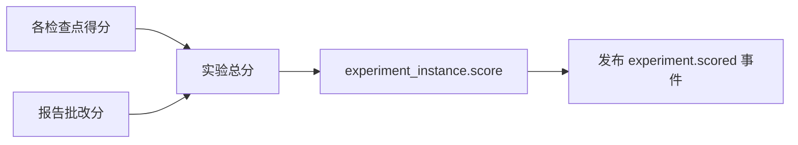

# M7 实验 — 业务流程与状态机

> Mermaid 描述实验配置发布、学生做实验编排、实例状态机、多人协作、检查点判分。
> 最后更新:2026-11-27

---

## 1. 教师配置实验(向导式)

向导的“保存草稿”只持久化当前编辑内容和所在步骤,不得因当前步骤尚未完整而阻止保存;这是跨刷新/关闭重开的服务端草稿,不是发布有效性声明。只有“保存并进入下一步”才执行当前步骤的必填校验,发布前校验/正式发布再执行完整结构、依赖和成绩契约校验。服务端仍校验持久化数据的字段格式、组件 ID、引用关系和安全边界,不接受非法结构。

---

## 2. 学生做实验编排流程

> 发布前校验包含结构、分值、M5 锁定版本和每个环境 `CompositionSpec` 编译校验。正式发布前，M7 按冻结摘要调用 M2 准备完整镜像闭包，失败则不得发布；创建仍复核该证明。实例保存稳定 `source_ref` 与本次运行 `scope_ref`：M2/M4 用前者校验归属、后者回收和恢复。M3 每次学生判分使用独立提交来源，reuse 单独携带实例来源。引擎创建失败按本次作用域补偿后进入错误态。

> 完成实例时,M7 在实例锁内读取已触发检查点的 M3 当前结果;存在 queued/judging 任务则返回 `74008`,学生刷新后重试完成。终态结果先同步检查点，再汇总报告、固化得分与 `experiment.scored` outbox，整段同事务提交，不依赖事件回写时序。完成接口的重试只续跑 M2/M4 回收,不得重复汇总或重复生成得分事件;已回收实例直接幂等返回。检查点或报告的终态回写若改变已完成实例的总分,在同一实例锁内生成递增 `score_revision` 的 `experiment.scored` outbox 事件;事件重投不会生成重复修订,通知消费者以稳定事件 ID 幂等。

---

## 3. 实验实例状态机

- 通用转换校验允许错误目标态；实际入口仍须锁内核对当前状态、代次和引用，不能据此把已完成/已回收实例回退。
- 回收只释放引擎资源(M2/M4),实验结果(检查点/报告/得分)保留。
- **操作状态以权威状态源为准**:检查点判分仅允许实例处于 `running` 或 `paused`;实例当前阶段引用 M2 沙箱时,页面还须读取该阶段沙箱实时状态,只有沙箱处于 `ready` 阶段且状态允许进入工作区时才开放判分。暂停仅允许实例处于 `running`,并须逐一确认当前实例引用的 M2 沙箱已到 `ready` 阶段且状态允许暂停。`SandboxRef.tools` 是创建时的工具接入摘要,不得作为沙箱生命周期或判分/暂停按钮的判断依据;服务端仍须通过 M2 保存工作区并校验沙箱归属与执行状态。
- 创建未激活阶段只允许在 `running` 实例进行。暂停实例先经 `resume` 恢复当前所有沙箱，再激活新阶段；已激活阶段的读取不切换实例状态。
- **完成回收补偿**:得分已落库但同步回收失败时,实例保留在已完成态。M2 的可靠 `sandbox.recycled` 事件只有在确认该实例全部沙箱均已销毁后,才续跑 M4 回收并推进已回收态;学生重试完成接口也执行同一幂等续跑。单个组件的回收事件不得提前代表整实例已经回收。
- **回收落库**：完成、超时、课程结束和完成态事件补偿共用一条路径；引擎调用后，在实例锁内核对原状态、作用域及沙箱、仿真引用。期间已暂停、完成、重建或新增资源则显式返回冲突供重试，不覆盖新环境；同代已回收时不再写状态，结算及修订保留当前得分。后台扫描只认领时间窗，不锁定事务外的生命周期。
- **课程结束清理**：扫描课内所有非已回收实例，完成态和错误态也可能因补偿失败保留资源，不能遗漏；检查点、报告和成绩仍保留。
- **断点续做与生命周期同步**:M2 沙箱被独立回收时发布 `sandbox.recycled` 事件,experiment 订阅后先在实例行锁内确认事件沙箱仍属当前资源引用、全部引用沙箱均已销毁，再将实例转"环境已释放"(逻辑态,持有代码持久化引用)；旧沙箱的迟到事件和单组件回收不能释放新环境或整组环境。学生恢复时 experiment 使用稳定 `source_ref`、原组合快照 digest 和新的 `scope_ref` 重建环境(M2 拉回代码 + 重放部署脚本)再进入"进行中"。入口读取对账还须在行锁内核对当前运行代次和状态，防止旧快照覆盖完成、回收或重建。避免持失效 sandbox_ref 或跨年重算来源引用。用事件解耦,sandbox 不反向依赖 experiment(见工程目录设计 §3.1.1)。
- **暂停超时回收**:已暂停长时间不恢复则回收,防僵尸。
- **错误态补偿回收**:组件部分拉起失败(如 M2 成功但 M4 失败)时,错误态清理需**补偿回收已成功起的另一组件**(调 M2/M4 回收),不残留半截资源。
- 阶段内资源并发创建使用 `errgroup.Group` 等待全部任务，单个创建失败不取消其他创建；等待结束后返回部分成功引用及原始错误，由现有补偿流程释放。不在等待完成前读取并发结果。
- **异步启动失败对账**:M2 启动或个性化初始化失败后发布 `sandbox.failed`;M7 按稳定 `source_ref` 找到实例,按失败沙箱所属 `scope_ref` 补偿回收全部已创建引擎资源,再写入 `error`。事件投递存在时间差时,实例工作台和教师监控读取 M2 权威沙箱状态执行同一对账,不得让实例永久停留在 `creating/running`。
- **错误态恢复**:错误实例不承载学生可操作工作面,但不是结果终态。学生点击「重建实验环境」后,M7 先确认旧作用域已回收,再复用已保存的公开工作区归档、生成新的 `scope_ref` 并重新编排;重建失败保持 `error`,允许用户在同一实例上重试。
- **控制操作落库**：暂停与恢复调用引擎后，在实例锁内复核原状态、运行代次和访问权限；过期操作不能覆盖期间已完成、释放或重建的实例。重建成功一次提交新作用域、资源引用和运行态，不追加状态补写；失败只清理本次新资源。清理失败时保留新作用域与残余引用，且仅在原实例仍未变化时写错误态，供重试继续清理。首次创建同样必须复核创建态及作用域后绑定资源。
- **引擎联动清理**：释放态和错误态恢复前都清理旧作用域；M2 已释放不代表 M4 已结束。两类资源均尝试清理，失败合并错误并阻止后续重建或回收终态。没有沙箱的实例跳过归档读取，可独立恢复仿真。
- **失败事件代次**:失败事件与入口读取均只补偿原作用域，补偿后在实例锁内复核运行代次和状态；旧快照不得把已重建的新环境推进错误态。
- **契约缺失显式失败**:实例已有沙箱或仿真引用时,完成、超时、课程结束和失败补偿等回收路径必须要求对应 M2/M4 契约可用;缺契约不能视为回收成功,避免引擎资源实际残留。

---

## 4. 多人协作流程

> 不做实时协同编辑;协作通过共享链状态实现。

---

## 5. 检查点判分流程

---

## 6. 得分汇总与事件发布

已完成或已回收实例的报告批改复用首次完成的检查点终态同步，避免重判事件回写延迟时再次发布旧总分。当前任务尚未完成则提示稍后重试；检查点、报告、实例总分与得分事件同事务提交，失败整体回滚。进行中的实例只保存报告批改，留待完成时结算。

