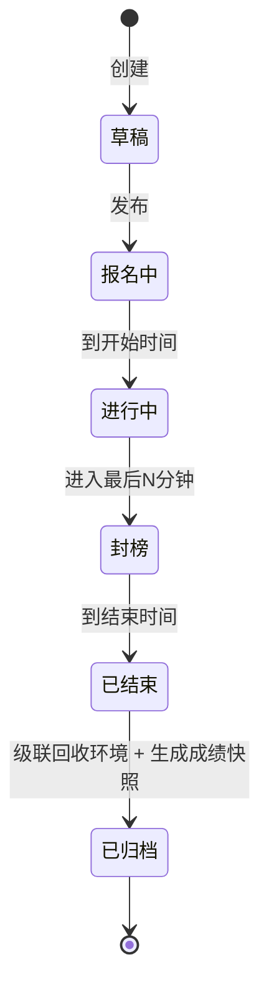
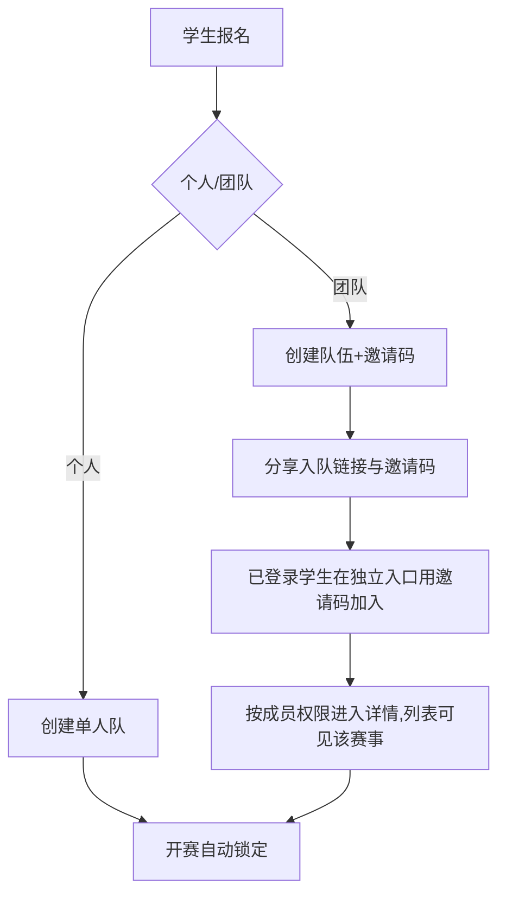
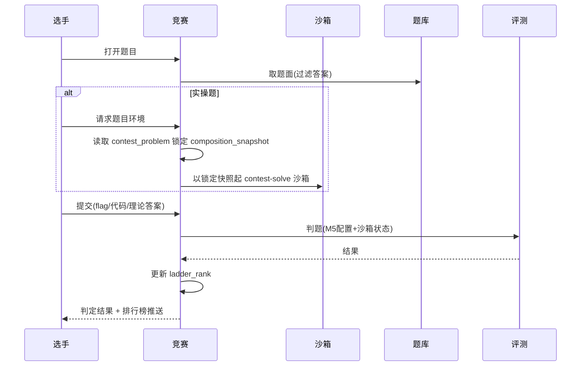
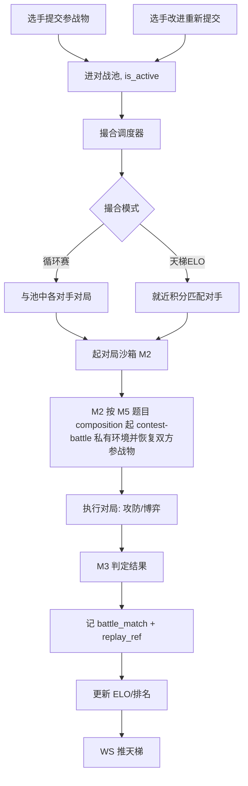
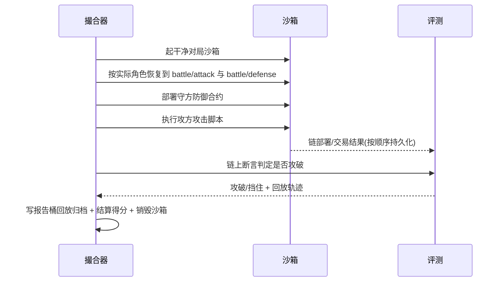
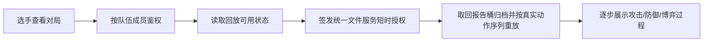
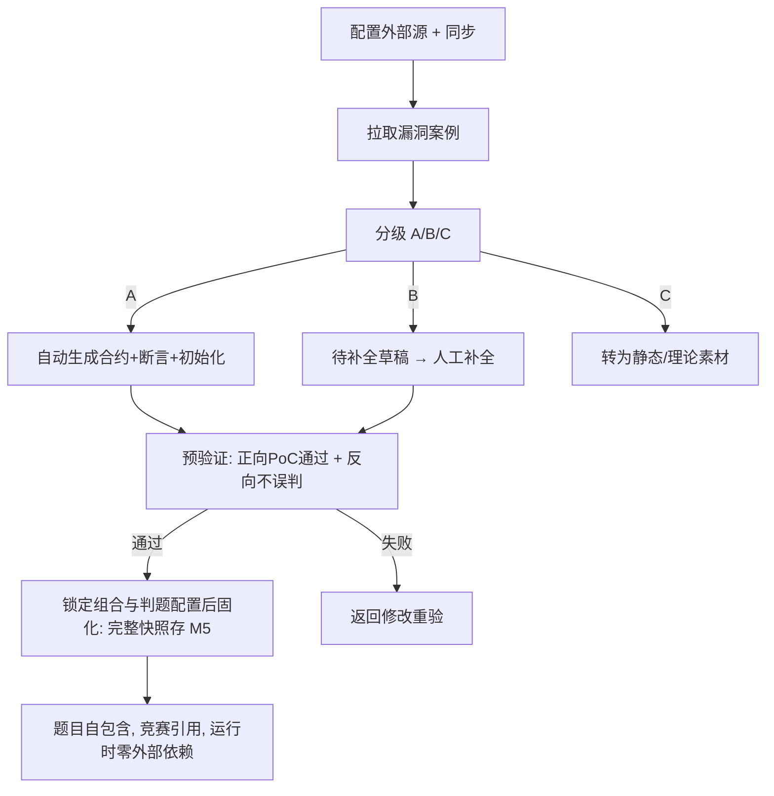
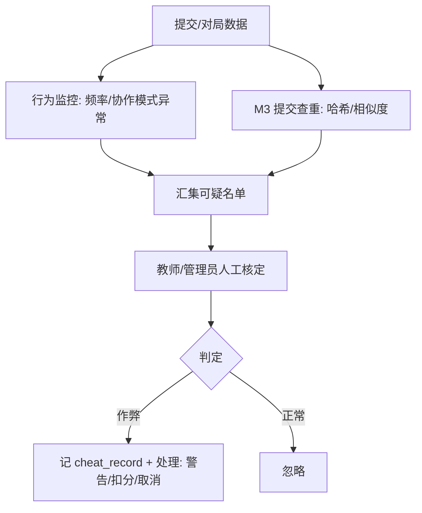

# M8 竞赛 — 业务流程与状态机

> Mermaid 描述竞赛生命周期、解题流程、对抗撮合、回放、漏洞转化。
> 最后更新:2026-11-24

---

## 1. 竞赛状态机

- 封榜期:排行榜冻结显示,提交仍判定但排名不实时公开。
- 人工发布、开赛、封榜和结束在同一租户事务中写入状态、附属数据及 M1 审计；失败一并回滚。结束后的连接关闭与撤权广播在提交后执行，失败不撤销已提交的结束状态和审计。
- 自动推进先经 M8 维护连接只读定位待处理学校，再逐校进入普通租户事务；沿原时间窗口和 `FOR UPDATE SKIP LOCKED` 顺序处理结束、开赛、封榜，与 M1 系统审计一同提交。一校失败回滚该校本轮写入并汇总错误，继续处理其他学校；调用取消则停止后续学校。开赛后已在封榜窗口的赛事仍在同一事务继续封榜，两次流转分别审计。提交后才关闭本校被撤权连接。
- **已结束 → 已归档**(A5 修复):竞赛结束时执行收尾——① 按每个比赛运行范围调用 `POST /sandboxes/recycle(scope_ref=...)` 级联回收所有解题赛环境与对抗对局沙箱(稳定 `source_ref` 只用于归属校验);② 生成竞赛成绩快照存档(B11 个人战绩档案)。
- 人工与定时归档共用收尾流程；资源回收完成后，最终快照、归档状态和对应主体的 M1 审计在同一租户事务提交。人工不重复记录自动归档审计；最终提交失败保留结束态与既有租约，已撤权或回收的资源不恢复。
- 发布竞赛前,按题目冻结的每个组合摘要由 M2 预拉取完整镜像闭包;任一组合准备失败时竞赛保持草稿,不开放报名。漏洞题正反向预验证也必须在创建临时沙箱前准备其刚编译的准确摘要。运行阶段只消费已锁定摘要,M2 创建/恢复仍复核该摘要的当前成功证明。

---

## 2. 报名组队

报名、邀请码入队和锁队均在主办学校的现有事务中完成业务写入与 M1 审计；审计失败则不创建队伍、不加入成员、不锁定名单。重复报名返回已有队伍时仍记录本次审计。审计保留真实操作者，详情记录其学校。

---

## 3. 解题赛流程

M3 任务受理后，M8 取得赛事父行锁，按接口 §4 重核当前提交上下文与频率，再将提交记录、即时判分、排名、榜单待推送标记和提交审计在同一主办学校事务中提交；校验或审计失败回滚这些 M8 写入。M3 任务与此前的 M2 工作区归档不属于此事务。后台持有同一赛事锁复核赛态，发送榜单变化通知，发布成功后清除待推送标记；失败保留标记等待重试，不改变提交响应。处罚和异步判分复用同一排名与推送路径。

实操环境创建与成员授权必须作为同一业务流程处理：同一队伍、题目和`request_ref`复用M2唯一沙箱。M2创建成功但M8成员grant事务失败时，返回原竞赛环境不可用错误并保留错误链；沙箱继续由原幂等键定位，重试POST只补齐授权，不能直接销毁可能已被并发请求授权使用的环境。未继续重试的资源由M2既有空闲/最长生命周期及竞赛结束回收处理，不增加第二套清理任务。GET恢复入口必须再次核验当前成员的grant；授权缺行时返回资源不存在以保留准备入口，查询失败显式报错，已撤销、过期或来源/队伍不符的授权拒绝访问。漏洞预验证、对局失败标记、沙箱回收及回放对象清理的组合错误逐项保留原因，不将后续失败格式化为不可解包的文本。

重复准备的授权写入沿用M8唯一upsert,由数据库在冲突更新时比较能力、来源、有效期及状态;未变化则保持授权版本,实际变化才递增。不能先读后写判断版本,避免并发请求漏掉权限变更。撤销路径保持版本递增,提交保存后仍复核最新版本和完整题目/队伍范围;不通过去掉二次校验来规避无效版本更新。

---

## 4. 对抗赛撮合流程

参战物归档在事务外保存；写入时锁定赛事父行，复核当前赛制、状态、题目和成员，再在同一主办学校事务内分配版本、停用旧版本、创建新参战物及对局并由 M1 写提交审计。任一步失败均回滚本次 M8 写入。与赛事状态变更共用已有行锁，保证同队并发提交的版本递增，结束操作与提交不会交错写入。

私有对局沙箱、判题提交者和任务归属均使用主办学校的组织教师；执行前从赛事读取，不借用队长或任意成员账号。双方队伍及锁定的参战物由对局记录关联，成员变更不改变已撮合对局的资源归属；赛事读取失败时不创建沙箱或提交判题。

---

## 5. 对抗对局执行(攻防类)

---

## 6. 对局回放

---

## 7. 真实漏洞转化流程

---

## 8. 防作弊判定

