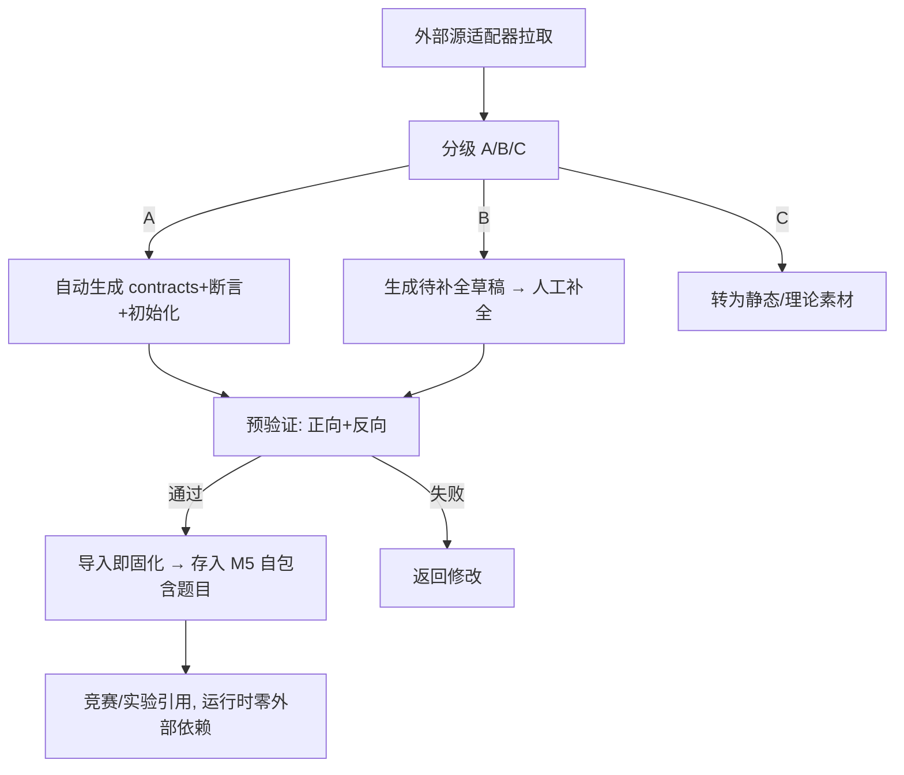

# M8 竞赛 — 专题设计:对抗赛撮合与真实漏洞源

> M8 两大技术核心:① 对抗赛异步撮合 + 天梯 + 回放;② 真实漏洞外部源接入与转化。
> 最后更新:2026-11-28

---

## 一、对抗赛异步撮合

### 1. 为什么异步

区块链对抗本质是**代码 vs 代码**(攻击脚本 vs 防御合约,策略合约 vs 策略合约),选手智慧固化在提交物里,无需实时操作。异步比实时在线对战复杂度低一个数量级,且天然支持回放。

### 2. 提交即参战 + 天梯撮合(创新)

```
选手提交参战物(防御合约/攻击脚本/策略合约)
   → 进入对战池
   → 撮合调度器持续两两撮合
   → 每局在 M2 干净沙箱执行 → 判定 → 更新天梯积分(ELO)
   → 选手可改进后重新提交,触发新对局
```

类似 AI 模型竞技场 / Codeforces 天梯,持续参与感强。

### 3. 两种对局规则(题目级配置,非赛制分类)

> 赛制只有"解题赛/对抗赛"两种。下面是对抗题的两种**对局规则**,由出题时 `contest_problem.battle_rule` 配置,决定该题对局如何进行。

**攻防型规则:**
```
守方提交防御合约(实现功能 + 无漏洞)
攻方提交攻击脚本
撮合:干净沙箱部署守方合约 → 跑攻方脚本 → M3 链上断言判定是否攻破
得分:攻破→攻方得分;挡住→守方得分
```

攻防型的唯一胜负事实是 M3 完整断言结果的 `passed`:通过表示攻破、攻方胜,未通过表示守住、守方胜。M8 必须用本局参战物的实际角色映射到 A/B,不得把 A 固定当攻方,也不得从断言明细的展示文字推断胜方。

参战物的执行路径同样按角色确定:攻防型的攻方恢复到 `battle/attack`,守方恢复到 `battle/defense`;M5 的链步骤使用对应 `/workspace/battle/attack`、`/workspace/battle/defense`。A/B 只表示撮合双方,不能决定攻守路径。博弈型双方均为策略角色,按 A/B 分别恢复到 `battle/entry_a`、`battle/entry_b`。不建立旧目录别名或重复恢复归档。

恢复双方归档后，M8 将本局沙箱来源和锁定组合摘要提交 M3。M3 再核验 M2 的 `contest-battle` 私有访问类型、归属与就绪状态，执行锁定题目的 `chain_steps`，随后检查断言并记录脱敏回放；禁止只恢复归档就读取初始状态结算。缺少执行程序的题目不得加入对抗赛。执行失败不产生胜负，沿既有失败事件回收；不在同一环境中自动重试或原地重判，新一局使用新的干净环境。官方漏洞攻击仍仅用于出题预验证。

**博弈型规则:**

M5 锁定题目的链上断言必须包含唯一的 `outcome: true` 结果声明（`op: "exists"`、非空 `target/field`），查询指定字段得到严格枚举 `a_win/b_win/draw`。M8 加入赛题时通过 M3 检查此能力；正式提交把规则绑定到 M3 `RequiresOutcome`，正式结算只读取 M3 结果明细的 `outcome`，要求完整断言通过且结果唯一。缺失、非法或重复结果不结算；禁止解析展示摘要、接受别名或从其它明细推断胜负。双方策略仍在私有沙箱执行，链动作及脱敏结果完整归档。
```
双方提交策略合约
撮合:沙箱部署双方合约 → 链上博弈多轮 → 按收益/胜负判定
得分:按对局结果给天梯积分
```

### 4. 撮合调度

对局启动先确认本次 token 租约，再由 [background.WithRenewal](../总-后端层能力索引.md#internalplatformbackground) 管理续租和退出。失去租约取消外部调用，不覆盖新持有者状态或清理其资源；正常完成及异常退出都须等待续租调用结束。持有者验证、状态 CAS 和资源补偿仍由竞赛模块负责。

| 模式 | 说明 |
| --- | --- |
| 循环赛 | 池中选手两两都打一遍,适合小规模赛 |
| 天梯(ELO) | 按积分就近匹配对手,适合大规模/持续赛 |
| 触发 | 新提交/改进提交触发与若干对手的新对局 |

- 撮合任务入队,worker 调 M2 起对局沙箱执行,异步回写结果。
- 终态事件由同一结算入口处理,后台撮合任务通过 M3 contract 补偿漏收事件。单局读取或结算失败必须记录租户、对局和判题任务上下文,继续处理同批其他对局及新对局认领;不得让一条坏记录阻塞整个撮合队列。M3 失败原因留在内部结构化日志,不对选手暴露判题内部信息。
- 每轮补偿固定扫描开始时间,按对局 ID 游标分批遍历该时间前已启动的待结算对局;未完成或失败的最早一批不得饿死后面的对局。结算事务统一先锁定所属赛事和对局,再读取当前 ELO、写终态和刷新榜单,避免多副本重复结算或不同对局覆盖同一队伍分数。
- 回放归档和积分事务同时留下赛事榜单待推送标记；提交后完成资源回收与统一审计才确认对局终态事件，榜单由赛事统一后台交付，不绑定对局收尾。重复事件读取已持久化结果，续跑回收与审计，不重复算分、不删除已被对局引用的回放。事件消费失败继续走现有重试和死信机制。
- 每次归档写入独立对象。上传失败或结算回调失败时，按统一 `UPLOAD_CLEANUP_TIMEOUT_SECONDS` 脱离请求取消清理本次对象，并保留全部错误原因；已尝试提交回放引用后报错则保留对象，不以事后查询判断原提交是否生效。并发重复结算只清理本次未采用的归档，已引用回放保持不变。
- 对局确定性:固定沙箱镜像 + 固定初始状态,保证可复现可回放。
- 天梯积分使用标准 ELO 期望分公式:`EA = 1 / (1 + 10^((RB-RA)/400))`,`ΔA = K * (SA - EA)`,`ΔB = -ΔA`;胜/负/平分别取 `SA=1/0/0.5`。初始分和 K 因子统一来自环境变量 `CONTEST_BATTLE_ELO_INITIAL_SCORE`、`CONTEST_BATTLE_ELO_K_FACTOR`,撮合就近匹配与结算必须使用同一配置。

### 5. 对局回放

```
每局归档:初始状态 + 双方参战物引用 + 有序脱敏动作与输出 + 判定结果
回放 = 读取归档，前端按动作游标展示当时结果，不创建沙箱或重新执行交易
```

- 选手赛后看回放:一步步看攻击怎么打、防御怎么破、博弈怎么输。
- 回放数据存储与取件以接口设计为准；记录已执行事实，不把重新运行等同于历史回放。

---

## 二、真实漏洞外部源

### 1. 多源接入(可插拔适配器)

| 源 | 内容 | 典型用途 |
| --- | --- | --- |
| SWC Registry | 标准合约弱点分类 + 示例代码 | 自动生成 isolated 草稿题 |
| 公开漏洞情报(Rekt/SlowMist 等) | 真实安全事件元数据/源码/PoC | A/B 级链上题 |
| CVE / 链上事件 | 有链上记录的真实攻击 | forked 复现题 |

新增源 = 增加一条 `vuln_source.config` 配置,不改平台代码(呼应平台插件化)。M8 后端按配置驱动的通用源适配器执行同步,把外部案例拉取为 `vuln_problem` 草稿;预验证通过后仍由 finalize 调 M5 `system-import` 固化为自包含题目。

平台共享源由平台维护，教师只读配置、可同步为本校草稿；本校来源由本校教师维护。同步共享源不写共享记录或同步时间，仍在本校事务内写草稿和审计。列表用派生 `is_shared` 表达归属，共享源隐藏修改入口及同步时间，不新增表。

`vuln_source.config` 结构:
```json
{
  "endpoint": "https://example.edu/api/vulnerabilities",
  "method": "GET",
  "timeout_seconds": 10,
  "headers": {
    "Authorization": "Bearer <token>"
  },
  "body": {},
  "cases_path": "items",
  "mapping": {
    "external_ref": "id",
    "title": "title",
    "level": "level",
    "runtime_mode": "runtime_mode",
    "draft_body": "body"
  }
}
```

- `endpoint` 必须为公网 `http/https` 文本地址，去掉两端空白后校验和请求；保存与同步共用同一个配置解析入口。生产配置由出题教师或管理员维护，密钥类字段保存前加密。
- 配置保存整份替换，`headers` 和 `body` 都可编辑；敏感字段原样回传 `已配置` 保留同一路径密文，填写新值替换，删除或填空清除。新建不得使用占位值，更新时锁定所属来源后读取旧密文。
- `headers` 可省略；提供时必须是文本值对象，名称及值须符合 HTTP 标头规则，无效项拒绝保存，不能静默丢弃。空文本表示清除该项凭证，不发送该标头。
- `body` 是 POST 请求的 JSON 内容，省略时发送空对象；显式 `null`、布尔、数字、文本和数组保持其 JSON 值。GET 保留配置但不发送请求体。
- `method` 省略或空文本时使用 `GET`，提供时必须为文本，去掉两端空白并统一大写后只允许 `GET/POST`；`timeout_seconds` 为 1-60 的整数秒数，只有省略时使用环境变量 `CONTEST_VULN_SOURCE_TIMEOUT_SECONDS`；小数、`null` 或非法值拒绝保存，禁止截断或替换为默认值。
- 来源表单的等待时间可留空，创建和编辑都省略该配置以沿用平台设置，不填写固定默认值；显式填写才保存来源级覆盖。
- `cases_path` 省略或空文本表示响应根就是案例数组；提供时必须为文本，非空时按点路径从 JSON 对象中取案例数组。数组每项必须是案例对象；合法空数组可以同步，缺失路径、`null`、非数组和混入非对象的列表均报错，本次不写草稿或同步时间。
- `mapping` 必须为文本路径对象，`external_ref/title/draft_body` 路径不可为空；不转换数字、不忽略类型错误的可选路径。映射所得 `level` 支持 `1/2/3` 或 `A/B/C`，缺省用 `vuln_source.default_level`；`runtime_mode` 支持 `1/2` 或 `isolated/forked`，缺省为 `isolated`。提供的非空值必须能解析为已登记枚举，非法文本、非整数、溢出和对象不能替换为默认值。
- 同步只生成 M8 漏洞题草稿,答题运行时不直接依赖外部源。

### 2. 可复现性分级

| 级别 | 具备 | 处理 |
| --- | --- | --- |
| A 级 | 源码 + 初始化 + PoC + 可判定结果 | 自动转链上验证题 |
| B 级 | 源码 + 部分攻击路径,缺完整验证 | 生成待补全草稿,人工补全 |
| C 级 | 仅文章/报告/分类 | 转为静态/理论题素材,不自动生成链上题 |

### 3. 两种运行时

| 模式 | 说明 | 适用 |
| --- | --- | --- |
| isolated | 平台起干净测试链复现 | 可本地重建的漏洞、模板题、教学题 |
| forked | 从真实链指定历史区块派生隔离链 | 依赖历史链状态的真实 DeFi/协议漏洞 |

`forked` 使用已保存组合中的只读完整历史提供者。草稿 `fork_block` 必须为非负整数，并与历史提供者参数 `history_block_number` 一致；`history_block_hash`、`history_state_root`、`history_chain_id` 必须完整。工作区到提供者须有唯一显式 RPC link，绑定 `env:CHAIMIR_EVM_FORK_RPC_URL`，并要求启动依赖和沙箱内访问。M8 将该身份投影为工作区 `fork_*` 参数，再由 M2 按目录 schema、私有连接和不可变镜像编译；不按 runtime code 猜测历史能力。缺材料、身份冲突或旧普通链快照返回 `85005`，不得运行普通链后记录 fork 通过。固化复核同一冻结声明与快照；已固化记录重复读取不重导入。完整状态的镜像与容量约束见镜像规范“forked 运行时与特殊能力”。

### 4. 导入即固化(关键健壮性,解决"获取不到就废")

```
外部源数据导入
   → 组合声明与判题配置固化到 M5 题目，M8 保留预验证快照:
       合约源码 + bytecode + 初始化交易 + 验证断言
       + (forked) 锁定完整历史状态镜像 digest + 区块号/hash/state root/chain ID
   → 题目从此自包含
   → 运行时 / 学生答题完全不依赖外部源在线
```

- 外部源挂了/改了/删了,**已入库题目照常可用可答**。
- 外部源仅在**出题阶段**在线使用(同步情报、拉案例);答题运行时零外部依赖。
- forked 题锁定完整只读历史状态镜像与链身份，不依赖外部 RPC；Anvil 缓存只作运行期加速，不能替代历史库。

### 5. 预验证(保证可解可判)

```
Step1 部署测试环境(isolated 起隔离链 / forked 派生 Fork 链)+ 执行初始化
Step2 出题者/系统提交官方 PoC
Step3 正向验证:执行 PoC → 所有断言通过 = 漏洞确实可利用
Step4 反向验证:干净环境不执行 PoC → 所有断言失败 = 不会误判
Step5 双向通过 → 题目可提交审核入 M5
Step6 失败 → 返回详情,修改后重验
```

- 任何来源的题入库前必过预验证,杜绝"导进来却没法答"的废题。
- 预验证只作用于 `vuln_problem` 草稿;题目固化到 M5 后成为自包含只读题目,页面不再提供“重新验证”,服务端也拒绝对已固化或已弃用题目执行预验证。
- 断言复用 M3 的 `chainassert` 规则：查询结果缺少目标字段时不通过，显式 `null` 保留为合法值，`exists` 只检查字段存在性；正向必须通过，反向必须不通过。
- 断言类型:余额/代币余额/存储槽/owner/事件/代码/自定义脚本检查。

### 6. 转化流水线总览


