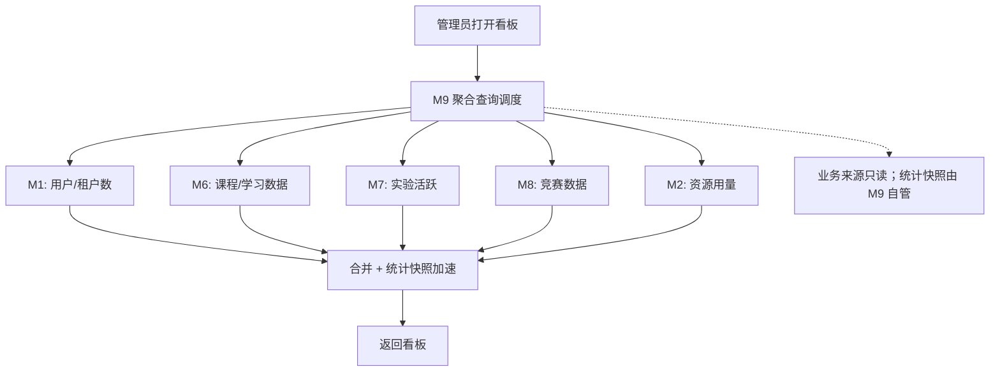
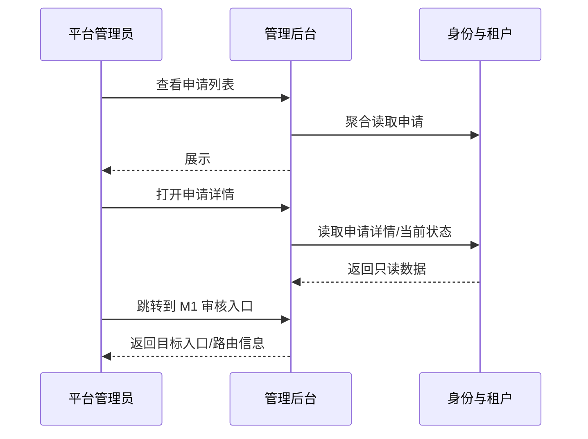
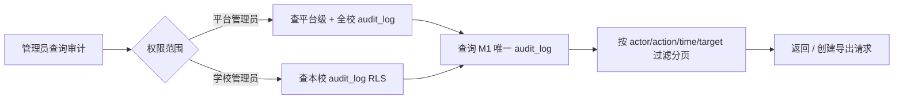
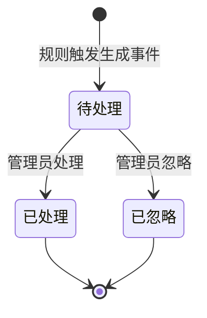
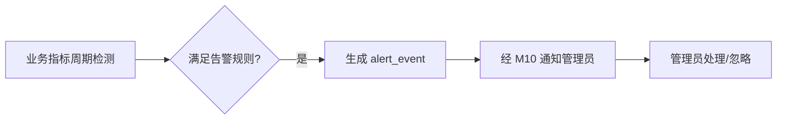
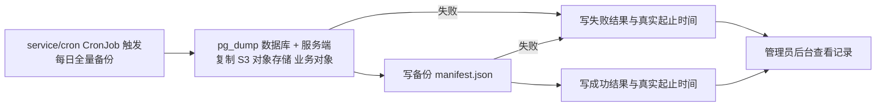

# M9 管理后台 — 业务流程与状态机

> Mermaid 描述看板聚合、审计查询、告警处理、备份。
> 最后更新:2026-11-28

---

## 1. 看板聚合(只读不跨写)

周期统计按同一统计日期独立生成平台和各校快照；平台汇总或单校读取、写入失败不阻断其他学校。本轮返回全部失败及所属范围，任一快照所需数据未读齐时不得写入部分结果或以零补齐。学校快照仍在所属租户事务内保存，平台快照由平台事务保存；取消后停止后续学校。

---

## 2. 学校入驻审核视图(M9 只读展示,M1 执行业务命令)

> 审核通过、驳回、创建租户、开通学校管理员账号都由 M1 自有接口完成。M9 只提供只读视图、筛选检索与入口跳转,不承接跨模块业务命令,也不转发写请求。

---

## 3. 统一审计查询

导出请求与操作审计同事务创建；失败则回滚并补偿 pending transfer 任务。规则修改和告警处理同样与审计原子提交，实时推送只在提交成功后进行。

> 审计导出请求由 M9 自有表保存完整筛选快照和发起账号,不把筛选字段写入 `transfer_task`。M9 worker 按 task ID 领取通用任务后重放查询、生成 CSV、写入统一文件服务并完成或失败任务;transfer 仅维护租约、重试和下载产物。

导出失败保留领取、执行、任务状态回写和下次扫描安排的完整错误链；补偿失败不能覆盖原始原因。领取结果遵循[transfer 契约](../总-后端层能力索引.md#internalplatformtransfer)：只有普通未领取才按权威任务状态对账，数据库或提交失败直接保留原因并安排下次扫描，不得被随后成功读取掩盖。单项失败不阻断后续请求，本轮向后台运行器返回全部失败及学校、任务编号，由运行器统一记录脱敏原因；取消后停止领取后续任务。任务被其他 worker 持有或已进入终态时，按权威任务状态延后扫描或清理请求，不重复生成产物。

---

## 5. 告警处理

平台规则逐校采样；满足阈值且持续指定时间后，评估状态和事件同事务提交。通知从事件原记录领取并经 M10 投递；同一异常期仅触发一次，人工处理不重置异常，观察到恢复后才允许再次触发。指标读取失败不能当作正常，采样中断后的未触发异常重新累计。

> 基础设施告警来自外接 Prometheus/Grafana；M9 仅按数据模型登记的八类业务指标告警。

---

## 6. 备份记录

> M9 只记录成功/失败结果；实际备份由受控 `service/cron` CronJob 执行。成功结果必须引用完整清单，失败结果不依赖对象存储写入，结束时间由执行方传入。HTTP API 不暴露对象引用和下载直链。
